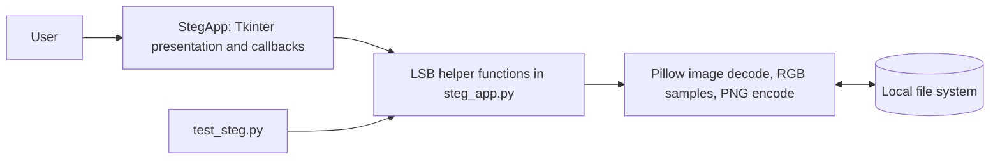
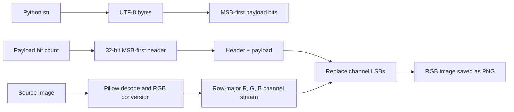
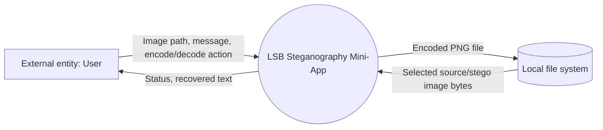
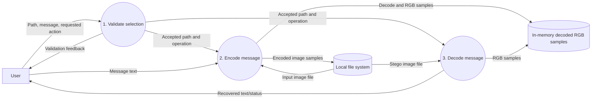
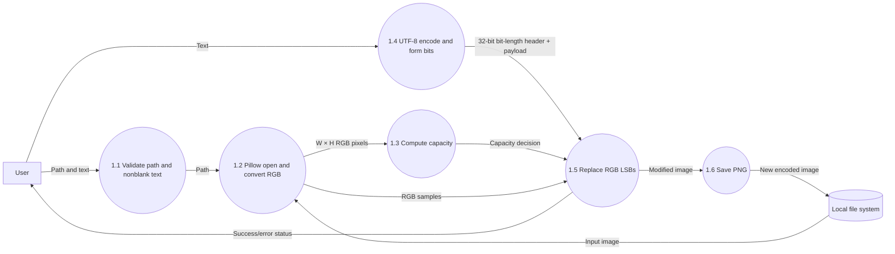
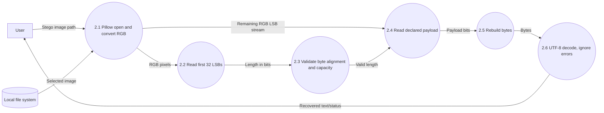
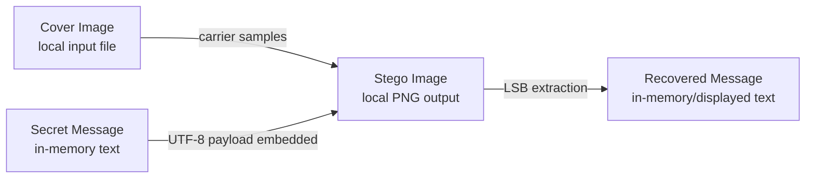
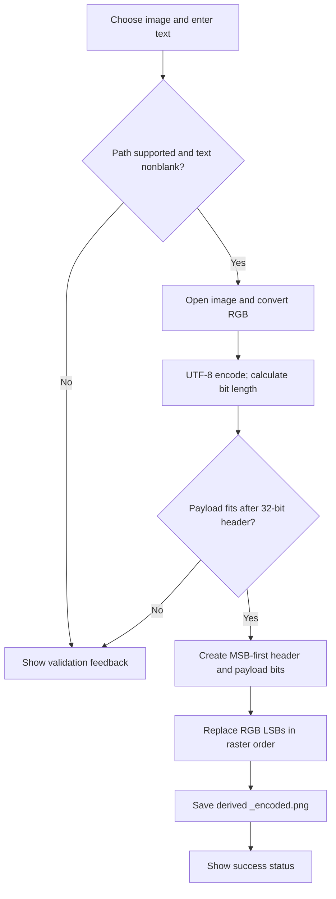
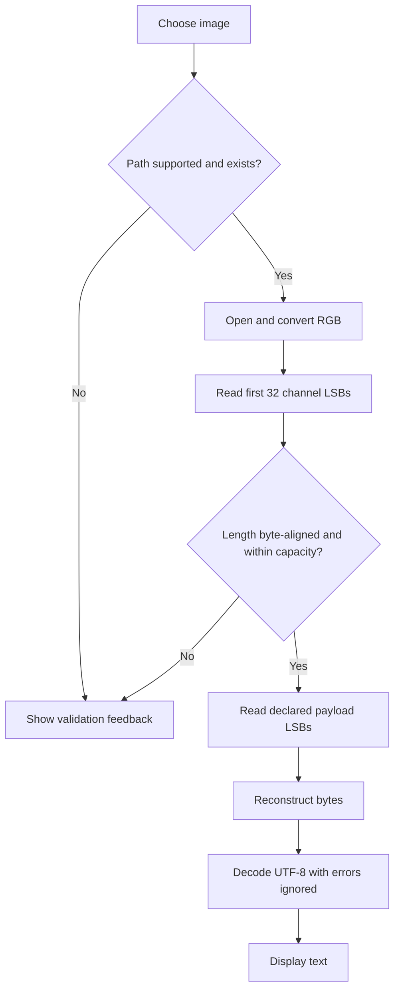

# LSB Steganography Mini-App

## Technical Project Report

**Document type:** Implementation-grounded technical report  
**Project:** LSB Steganography Mini-App  
**Prepared from:** Workspace source, tests, requirements, and project artifacts  
**Author, institution, supervisor, and submission date:** Not available in the current project; insert verified details before formal submission.

---

## Declaration

This report describes the implementation and test evidence present in the project workspace. It does not make a claim of authorship, originality, academic submission, or institutional approval on behalf of an individual. Any formal declaration required by an institution must be completed and signed by the responsible author.

## Certificate placeholder

> **Certificate placeholder — not an issued certificate.**  
> Project title: LSB Steganography Mini-App  
> Student name / identifier: [To be completed by the institution]  
> Supervisor: [To be completed by the institution]  
> Department / institution: [To be completed by the institution]  
> Date and authorized signatures: [To be completed by the institution]

## Acknowledgement

Names of supervisors, institutional staff, collaborators, and other contributors are not available in the inspected project files. Add acknowledgements only after confirming the people and contributions concerned.

## Keywords

Image steganography; least significant bit; RGB; Pillow; Tkinter; UTF-8; capacity; information security; desktop application.

The abstract, table of contents, lists of figures and tables, and abbreviations follow this front matter.

---

# Abstract

**Implementation note:** This report describes the earlier desktop-only version. The current Streamlit web app also supports authenticated encryption before embedding, using a generated key file by default or a password-derived key; plaintext mode remains available. The Tkinter desktop interface remains plaintext-only.

The LSB Steganography Mini-App is a local Python desktop program for embedding and recovering UTF-8 text in image samples by replacing least significant bits (LSBs) in RGB channel values. It addresses an educational problem: demonstrating how text bytes, image pixels, and a reversible bit-level transformation can be connected in an interactive program, while making clear that data hiding is not cryptographic confidentiality.

The implementation is a single Python module. Its Tkinter interface provides Encode and Decode tabs; Pillow opens image files, converts them to RGB, traverses pixel data, and writes the encoded result. The encoder prefixes the payload with a 32-bit, most-significant-bit-first integer containing the payload length in **bits**, then writes each UTF-8 payload byte most-significant bit first into the R, G, and B LSBs of pixels in row-major order. The decoder reads that header, checks alignment and image capacity, reconstructs bytes, and decodes with UTF-8 error handling set to `ignore`. The encoded output is saved as a new RGB PNG path derived from the selected input path.

The workspace test script has four test functions covering an ordinary round trip, rejection of an oversized message, a Unicode round trip, and three image dimensions. Running the script in the configured Python 3.14.4 virtual environment with Pillow 12.3.0 produced **4 passed, 0 failed**. This result is limited to those checks: the GUI was not exercised, no performance benchmark or image-quality metric was collected, and the repository’s `samples/placeholder.png` is a zero-byte file rather than a usable image.

The implementation is intentionally simple and keyless. Its predictable sequential embedding is vulnerable to inspection and statistical steganalysis; any observer with the image and algorithm can attempt extraction. There is no encryption, authentication, integrity check, payload magic value, or recovery mechanism. Re-saving through a lossy or otherwise pixel-changing transformation may corrupt the message. The project’s contribution is therefore a reproducible teaching example and an inspectable implementation of spatial-domain LSB embedding, not a secure communication channel.

**Keywords:** image steganography; LSB; RGB; UTF-8; Pillow; Tkinter; capacity; security analysis.

---

# Table of Contents

Front matter — [00_Front_Matter.md](./docs/report/00_Front_Matter.md)  
Abstract — [ABSTRACT.md](./docs/report/ABSTRACT.md)

1. [Introduction](./docs/report/01_Introduction.md)
2. [Objectives](./docs/report/02_Objectives.md)
3. [Scope](./docs/report/03_Scope.md)
4. [Problem Definition](./docs/report/04_Problem_Definition.md)
5. [Benefits](./docs/report/05_Benefits.md)
6. [Main Modules](./docs/report/06_Main_Modules.md)
7. [Technical Overview](./docs/report/07_Technical_Overview.md)
8. [System Configuration](./docs/report/08_System_Configuration.md)
9. [Block Diagram](./docs/report/09_Block_Diagram.md)
10. [Data Flow Diagram](./docs/report/10_Data_Flow_Diagram.md)
11. [Conceptual Data Model (ER Diagram)](./docs/report/11_ER_Diagram.md)
12. [Project Explanation](./docs/report/12_Project_Explanation.md)
13. [Coding with Detailed Explanation](./docs/report/13_Coding_Detailed_Explanation.md)
14. [Results and Analysis](./docs/report/14_Results_and_Analysis.md)
15. [Software Testing](./docs/report/15_Software_Testing.md)
16. [Conclusion](./docs/report/16_Conclusion.md)
17. [Bibliography / References](./docs/report/17_Bibliography.md)

Back matter — [LIST_OF_FIGURES.md](./docs/report/LIST_OF_FIGURES.md), [LIST_OF_TABLES.md](./docs/report/LIST_OF_TABLES.md), [ABBREVIATIONS.md](./docs/report/ABBREVIATIONS.md).

The compiled document is [PROJECT_REPORT.md](./PROJECT_REPORT.md).

---

# List of Figures

| Figure | Title | Location |
|---|---|---|
| 1 | Runtime component architecture | [Chapter 6](./docs/report/06_Main_Modules.md) |
| 2 | System block diagram | [Chapter 9](./docs/report/09_Block_Diagram.md) |
| 3 | Context data-flow diagram | [Chapter 10](./docs/report/10_Data_Flow_Diagram.md) |
| 4 | Level-0 data-flow diagram | [Chapter 10](./docs/report/10_Data_Flow_Diagram.md) |
| 5 | Level-1 encode and decode data flows | [Chapter 10](./docs/report/10_Data_Flow_Diagram.md) |
| 6 | Conceptual data model (not a database schema) | [Chapter 11](./docs/report/11_ER_Diagram.md) |
| 7 | Encoding workflow | [Chapter 12](./docs/report/12_Project_Explanation.md) |
| 8 | Decoding workflow | [Chapter 12](./docs/report/12_Project_Explanation.md) |
| 9 | Data-processing pipeline | [Chapter 7](./docs/report/07_Technical_Overview.md) |

Figures are expressed as Mermaid diagrams. Rendering depends on the Markdown viewer.

---

# List of Tables

| Table | Title | Location |
|---|---|---|
| 1 | Project objectives and evidence | [Chapter 2](./docs/report/02_Objectives.md) |
| 2 | Scope boundaries | [Chapter 3](./docs/report/03_Scope.md) |
| 3 | Threat model | [Chapter 4](./docs/report/04_Problem_Definition.md) |
| 4 | Module architecture | [Chapter 6](./docs/report/06_Main_Modules.md) |
| 5 | Function-to-module mapping | [Chapter 6](./docs/report/06_Main_Modules.md) |
| 6 | Technology stack | [Chapter 7](./docs/report/07_Technical_Overview.md) |
| 7 | Hardware and software requirements | [Chapter 8](./docs/report/08_System_Configuration.md) |
| 8 | Input/output contract | [Chapter 8](./docs/report/08_System_Configuration.md) |
| 9 | Error conditions and observed handling | [Chapter 12](./docs/report/12_Project_Explanation.md) |
| 10 | Capacity examples | [Chapter 14](./docs/report/14_Results_and_Analysis.md) |
| 11 | Test-case inventory and actual results | [Chapter 15](./docs/report/15_Software_Testing.md) |
| 12 | Implemented limitations and possible improvements | [Chapter 16](./docs/report/16_Conclusion.md) |

---

# List of Abbreviations

| Abbreviation | Meaning |
|---|---|
| API | Application programming interface |
| ASCII | American Standard Code for Information Interchange |
| DFD | Data-flow diagram |
| GUI | Graphical user interface |
| I/O | Input/output |
| LSB | Least significant bit |
| MSB | Most significant bit |
| PNG | Portable Network Graphics |
| RGB | Red, green, blue |
| RGBA | Red, green, blue, alpha |
| UTF-8 | Unicode Transformation Format, 8-bit |
| UI | User interface |

---

# Chapter 1 — Introduction

## 1.1 Background

Digital information is routinely transformed, stored, and transmitted as sequences of bits. Image steganography uses an image as a carrier and changes selected image samples to encode another data stream. This project demonstrates one direct spatial-domain method: replace the low-order bit of each of the three RGB channels with one payload bit. The project is small enough to inspect end-to-end: [steg_app.py](./steg_app.py) contains both the GUI and the image transformations.

## 1.2 Information security

Information security concerns protection against unauthorized disclosure, alteration, and disruption. This implementation is relevant to confidentiality as a teaching illustration, but its bit replacement does not itself establish access control, encryption, authentication, or integrity. The distinction matters because successful recovery by the intended user does not demonstrate security against an adversary.

## 1.3 Confidentiality

Confidentiality means preventing unauthorized parties from learning protected content. In the present program, the message remains in its original representation apart from UTF-8 encoding. No key or cipher is used. A reader who knows or discovers the fixed format can decode the message, so the application does not provide cryptographic confidentiality.

## 1.4 Data hiding

Data hiding places information inside a host object. In this application, the host is a decoded image represented as RGB tuples and the payload is text converted to bytes. The operation changes channel parity, not the file’s visible high-level structure.

## 1.5 Steganography

Steganography aims to conceal the existence of communication; NIST defines it as communication that hides the existence of the communication [1]. This program is an elementary example: there is no marker in the file format that tells an image viewer the payload exists, but the format is also fixed and unkeyed, making extraction straightforward for an informed observer.

## 1.6 Historical development

Concealment of messages predates digital computing, but this report does not attempt an unsupported historical survey. The implementation is specifically a modern spatial-domain, digital-image demonstration. A detailed historical chronology is not available in the project sources.

## 1.7 Digital steganography

Digital steganography changes or augments a digital carrier. Its effectiveness depends not only on recovering a payload but also on whether the changes remain inconspicuous and survive expected handling. The application implements direct sample modification only; it does not evaluate these properties experimentally.

## 1.8 Image steganography

An image supplies many sample values that can carry bits. Here Pillow decodes the selected file and the application reduces it to RGB. The pixel values—not compressed file bytes or metadata—are the embedding domain.

## 1.9 Spatial-domain steganography

Spatial-domain methods modify image samples directly. This application replaces sample LSBs, requiring only bitwise masking and insertion. It does not use a frequency transform, quantization coefficients, or adaptive content analysis.

## 1.10 Transform-domain steganography

Transform-domain schemes embed information in transformed image representations, such as frequency coefficients, and can offer different robustness/quality trade-offs. No transform-domain operation exists in the current source; this discussion is background only, not a project feature.

## 1.11 LSB steganography

For an 8-bit channel value `C`, the code applies `(C & 0xFE) | b`, where `b` is 0 or 1. This clears the original low bit and sets it to the payload bit. A channel changes by 0 or 1. The method is reversible only while the encoded samples survive unchanged and the decoder follows the same traversal and framing rules.

## 1.12 RGB representation

After `Image.open(...).convert("RGB")`, each pixel has three 8-bit components `(R,G,B)`. The algorithm's storage capacity is three bits per pixel. An alpha component, if present in the source, is discarded by RGB conversion; it is not used to store data.

## 1.13 Pixel structure

Pillow yields image pixels in row-major order when iterating `getdata()`. For each pixel the application processes red, green, then blue. This deterministic ordering is part of the informal file format: changing either order makes existing payloads undecodable.

## 1.14 Binary representation

Each UTF-8 byte has eight bits. Both the 32-bit header and each message byte are emitted most-significant bit first. The decoder reconstructs integers by shifting the accumulated value left and OR-ing the next bit. This is big-endian ordering at the bit-stream level; no separate byte-order field is stored.

## 1.15 PNG

PNG is a lossless raster-image format. Its decoded sample values can preserve embedded RGB LSBs through a PNG save/load cycle. The application always writes its output to a `.png` path; it accepts other image extensions at input, and Pillow then decodes and converts their samples. Merely changing the extension of an image does not make a lossy source suitable.

## 1.16 Lossless compression

Lossless compression reproduces the input samples exactly after decompression. That property is useful to this algorithm because the decoder depends on exact low bits. PNG’s specification describes a lossless image format [4]. It does not make the payload robust to later resizing, filtering, color changes, or lossy re-encoding.

## 1.17 Steganography versus cryptography

Steganography attempts to hide that a message exists; cryptography transforms message content under a cryptographic scheme. The app performs only the former. It contains no encryption library, password, or key management. A stronger design would encrypt and authenticate the payload before embedding it, but those mechanisms are not implemented here.

## 1.18 Motivation

The implementation joins text encoding, image processing, bitwise operations, GUI events, and file I/O in a compact example. This makes the code useful for demonstrating data representation and the limits of naive hiding without introducing a database or server.

## 1.19 Research gap

The project is not a research evaluation of competing steganographic methods. It does not quantify detection rates, image quality, payload efficiency, or robustness. Its appropriate contribution is implementation transparency and a runnable baseline from which controlled experiments could be designed.

## 1.20 Problem context

The immediate engineering problem is to encode a variable-length text message into a finite sequence of RGB channel LSBs and later recover exactly the declared number of bits. Correctness requires consistent UTF-8 conversion, a length prefix, matching traversal order, and a capacity check.

## 1.21 Proposed system

The system has one process and one source module: Tkinter gathers paths and text; `hide_message` or `extract_message` performs the pixel operation using Pillow; local files provide input and output. There is no service layer, database, or formal multi-module package.

## 1.22 Contribution of the project

The demonstrated contribution is a simple GUI and reversible sequential LSB encoding/decoding implementation with a 32-bit payload-length field, basic capacity validation, and four executable test functions. No novel algorithm or security guarantee is claimed.

## 1.23 Educational and technical significance

The code makes the relationship between a text byte and three RGB channel samples observable. It also exposes practical concerns—payload length, channel order, capacity, lossy transformations, tolerant decoding, and false positives—that are valuable in introductory security and image-processing study.

## 1.24 Limitations

The implementation is sequential, keyless, unencrypted, unauthenticated, and not robust to sample-changing operations. It has no format magic or checksum, and it ignores invalid UTF-8 bytes on extraction. The UI accepts multiple extensions despite PNG-focused labels and documentation. Its tests do not exercise GUI behavior.

## 1.25 Chapter summary

This project is best characterized as a local educational demonstration of spatial RGB-LSB data hiding. PNG output supports exact sample persistence, but neither PNG nor imperceptible-looking pixel changes provide security. The following chapters describe the implementation boundary, formal data model, and evidence precisely.

**Implementation trace:** [steg_app.py](./steg_app.py#L1), [requirements.txt](./requirements.txt), [test_steg.py](./test_steg.py).

---

# Chapter 2 — Objectives

The table distinguishes the intended purpose from what can be verified in the current code. “Evidence” refers to implementation or test coverage, not a claim that every desirable property has been proven.

| Objective | Purpose and rationale | Implementation and measurable evidence |
|---|---|---|
| 2.1 Primary objective | Demonstrate hiding and recovery of text in an image. | `hide_message` and `extract_message` provide the operations; the round-trip test checks exact ASCII recovery. |
| 2.2 Research objective | Provide a transparent baseline for discussing LSB trade-offs. | The deterministic algorithm can be inspected; no comparative or statistical experiment is implemented. |
| 2.3 Technical objectives | Combine Python, Pillow, and Tkinter. | `steg_app.py` imports these; `requirements.txt` declares `pillow>=10.0.0`. |
| 2.4 Functional objectives | Encode, save, select, and display recovered text. | Encode/Decode tabs call the helpers; four test functions exercise the non-GUI encoding path. |
| 2.5 Algorithmic objectives | Frame, embed, extract, and reconstruct payload bits. | A 32-bit payload-length-in-bits header and MSB-first RGB traversal are implemented. |
| 2.6 GUI objectives | Offer a simple event-driven desktop interaction. | `StegApp` creates two tabs, file dialogs, a single-line message entry, feedback labels, and decoded output. GUI execution itself was not tested. |
| 2.7 Data-integrity objective | Recover the original text when image samples are preserved. | Exact equality is asserted in round-trip tests. There is no cryptographic integrity check; “integrity” here means functional round-trip correctness only. |
| 2.8 Validation objective | Reject invalid selections and payloads that exceed capacity. | The UI checks file existence/extension and non-whitespace text; the encoder checks bit capacity; decoder checks header alignment and capacity. |
| 2.9 Testing objective | Check normal, Unicode, size, and capacity cases. | `test_steg.py` includes these four categories. No pytest/unittest framework, UI tests, or coverage report is present. |
| 2.10 Security-analysis objective | State what data hiding does and does not protect. | The report documents key absence, detectability, integrity, and transformations; the application has no security subsystem. |
| 2.11 Educational objective | Make data representation and LSB behavior inspectable. | Small helpers and direct Pillow operations expose the mechanics. No measured learning outcome is available. |

The tested result is limited to the specific inputs in [test_steg.py](./test_steg.py); see [Chapter 15](./docs/report/15_Software_Testing.md). No assertion measures invisibility, robustness, or production suitability.

---

# Chapter 3 — Scope

## 3.1 Functional scope

The program offers GUI-driven image path selection, one-line message input, encoding to a derived PNG path, decoding from a selected supported-extension file, and displaying extracted text. The reusable functions can also be called directly without constructing the GUI.

## 3.2 Technical scope

Implementation is limited to Python, Tkinter, Pillow, and in-memory RGB sample manipulation. There is no network service, database, command-line interface beyond starting the GUI or test script, or formal plugin/module architecture.

## 3.3 User scope

The controls target a single interactive desktop user. Accounts, roles, multi-user workflows, and access controls are absent. No usability study or supported user profile is documented.

## 3.4 Image scope

The browse filter and extension check accept PNG, JPG/JPEG/JFIF, BMP, GIF, WebP, and TIFF suffixes. Actual readability depends on Pillow and file contents. Both encode and decode convert opened images to RGB. The encoder writes PNG; it does not preserve alpha or explicitly preserve metadata. The project documentation’s PNG-only statements are narrower than the actual extension check.

## 3.5 Message scope

The functional API accepts a Python string and converts it to UTF-8. The GUI entry is single-line and rejects whitespace-only input. There is no file-payload embedding, arbitrary binary payload API, message encryption, or explicit maximum-message widget. Capacity is measured in UTF-8 **bytes**, not Unicode characters.

## 3.6 Platform scope

The project declares Python 3.x in its existing docs but no minimum Python version. The inspected workspace contains a Python 3.14.4 virtual environment on macOS. Cross-platform behavior is not established by test evidence.

## 3.7 Security scope

The project demonstrates concealment through fixed sequential LSB replacement. It does not implement cryptographic confidentiality, keying, integrity/authentication, steganalysis resistance, secure deletion, or adversarial robustness.

## 3.8 Testing scope

The test script covers ordinary ASCII round-trip, an oversized message, a Unicode string, and three image dimensions using generated solid-color RGB PNGs. The GUI, corrupted carriers, invalid header branches, exact capacity boundary, input extension matrix, and visual quality are not tested.

## 3.9 Research scope

The report gives an implementation-derived model, complexity and capacity analysis, and threat discussion. It does not report experimental PSNR/SSIM, runtime benchmarks, steganalysis results, or comparative algorithm performance.

## 3.10 Current limitations

Current limitations include:

- sequential, fixed, unkeyed embedding;
- no magic identifier, checksum, authentication, or error correction;
- UTF-8 decode uses `errors="ignore"`, which can silently remove invalid bytes;
- unrecognized images with a plausible length header may yield arbitrary text;
- resizing, cropping, filtering, palette changes, or lossy encoding can disrupt recovery;
- full pixel and bit lists are materialized in memory;
- the sample `samples/placeholder.png` is empty;
- README and usage guidance contain inaccurate capacity examples and PNG-only wording;
- GUI and performance are not covered by the current tests.

## 3.11 Excluded features

Encryption, password protection, keyed/permuted embedding, adaptive embedding, transform-domain processing, compression, error correction, file attachments, networking, batch processing, database persistence, progress reporting, and steganalysis are not present.

## 3.12 Future research scope

Future work could compare keyed and content-adaptive schemes, add authenticated encryption and a versioned payload header, test robustness against explicit transformations, measure image distortion and detection rates, reduce allocation overhead, and automate GUI tests. Such features must be labeled as future work until implemented and validated.

**Traceability:** [steg_app.py](./steg_app.py#L149), [test_steg.py](./test_steg.py), [README.md](./README.md), [docs/usage.md](./docs/usage.md), [samples/placeholder.png](./samples/placeholder.png).

---

# Chapter 4 — Problem Definition

## 4.1 Problem background

An image has a finite number of decoded color samples. A text payload has a variable number of bytes. A reversible hiding operation must map payload bits to sample bits, preserve their order, encode the payload boundary, and reject data that does not fit.

## 4.2 Communication privacy

Privacy may concern either message content or the fact that a message is being communicated. The program addresses only a basic form of the second concern by placing bits inside image samples; it does not protect content if the hidden payload is extracted.

## 4.3 Visibility of communication

The output remains a normal image file, but its RGB least significant bits carry a regular sequential bitstream. File appearance alone does not establish that the image is statistically indistinguishable from an ordinary cover image. No such experiment was conducted.

## 4.4 Conventional encryption

Encryption protects content by transforming it under a cryptographic algorithm and key. No cryptographic transformation occurs in this application. The message is directly recoverable in its UTF-8 representation by following the fixed header and traversal.

## 4.5 Steganographic approach

The implemented approach selects every RGB sample in raster order and replaces its lowest bit until the header plus message has been written. There is no random selection, key, adaptive location choice, or payload encoding beyond UTF-8.

## 4.6 Technical problem

Given an RGB image of width `W` and height `H`, and a message `m`, encode enough information in the image so that a matching decoder returns `m`, provided the sample values remain unchanged and the payload fits.

## 4.7 Data representation problem

The Python string must become bytes using UTF-8, and each byte must become eight ordered bits. The implementation uses the most-significant bit first for each byte. The header stores payload length in bits, also most-significant bit first.

## 4.8 Capacity problem

There are `3WH` RGB channel positions, one bit per position. The first 32 positions carry the length field, leaving `3WH - 32` bits for the payload. A payload of `M` UTF-8 bytes fits when `8M <= 3WH - 32`. If the expression on the right is negative, no payload, not even a complete header, fits.

## 4.9 Extraction problem

The decoder must read the same R-G-B order, reconstruct the fixed 32-bit bit count, verify that it is byte-aligned and within capacity, then reconstruct exactly that many payload bits. The implementation has no magic value to establish that an arbitrary image was produced by this encoder.

## 4.10 Validation problem

Validation exists at two levels. The GUI checks a nonempty existing path with an allowed suffix and rejects whitespace-only input. The core encoder checks payload capacity. The decoder checks minimum header capacity, bit-count divisibility by eight, and maximum capacity. It does not validate content authenticity or a payload signature.

## 4.11 Reliability problem

Exact recovery depends on sample preservation and matching decoder assumptions. PNG output supports lossless storage, but external transformations can alter LSBs. No redundancy or error correction repairs changed bits.

## 4.12 Security problem

The same deterministic format that makes the teaching implementation understandable also makes extraction simple. An observer can inspect channel LSBs, read a fixed 32-bit header, and recover bytes. There is no secret key, encryption, authentication, or defense against statistical detection.

## 4.13 Formal problem statement

Let `I` be an RGB image with `W × H` pixels and let `m` be a Unicode string. Let `B = UTF8(m)` and `L = 8|B|`. For `L <= 3WH - 32`, construct a channel-bit sequence consisting of `L` encoded as an unsigned 32-bit MSB-first integer followed by the MSB-first bits of `B`. Replace the LSBs of the first `32 + L` RGB channel samples in raster order with this sequence. Given the resulting image and unchanged samples, recover `L`, reconstruct `B`, and return the UTF-8 decoded text. The program does not define behavior for adversarial authenticity or error recovery.

## 4.14 Proposed approach

The implementation uses Pillow for image decoding/conversion and output, Tkinter for interaction, and Python integer/byte operations for bit framing. The formal algorithm and actual code are described in [Chapter 7](./docs/report/07_Technical_Overview.md) and [Chapter 13](./docs/report/13_Coding_Detailed_Explanation.md).

## Threat model

| Actor capability | Threat | Impact in this implementation | Existing mitigation / residual gap |
|---|---|---|---|
| Obtain the stego image | Read RGB values and apply known fixed extraction | Payload can be recovered without a key | None; no encryption or key |
| Inspect pixel values/statistics | Detect non-natural LSB patterns or infer embedding | Disclosure of hidden communication | No keyed/adaptive embedding or detection evaluation |
| Modify image samples | Change, clear, or randomize LSBs | Payload corruption or arbitrary output | Capacity checks only; no checksum, MAC, or correction |
| Re-encode or resize image | Trigger quantization/interpolation or sample remapping | Header/payload becomes invalid or changes | Recommend preserving PNG samples; no transformation resistance |
| Supply malformed image file | Exercise Pillow decoding and GUI exception paths | Operation failure; resource consumption depends on file | Pillow parsing errors reach UI catch block; no explicit file-size/pixel limit |
| Choose a non-stego image | Interpret initial LSBs as a length | Error or false-looking text if header is plausible | Plausibility checks only; no magic identifier |

This is an educational threat model, not a penetration test. The application is not designed to defend against these actors.

---

# Chapter 5 — Benefits

## 5.1 Educational benefits

The program gives a concrete example of converting a human-readable string to bytes and modifying image samples. Students can compare input/output pixels and inspect the exact bit-level operations. Learning outcomes have not been measured.

## 5.2 Software engineering benefits

The implementation exposes a complete desktop path from user event through input validation, processing, file output, and feedback. It also illustrates how a monolithic source file can still contain identifiable functional responsibilities. Separation into an algorithm module and UI module would improve maintainability as scope grows.

## 5.3 Cybersecurity learning

The app demonstrates concealment while creating a useful opportunity to discuss why concealment is not encryption. Its fixed, keyless format is a practical example of a design that should not be relied on for confidential communication.

## 5.4 Image-processing learning

Converting images to RGB and traversing pixel tuples demonstrates a sample-domain manipulation. Alpha and metadata are not preserved explicitly, which also illustrates that format conversion can have consequences beyond the visible RGB appearance.

## 5.5 Algorithm understanding

The 32-bit length prefix illustrates framing: the receiver learns how many payload bits to read. MSB-first shifts and masks make bit order observable and testable.

## 5.6 GUI development

Tkinter demonstrates windows, themed controls, event callbacks, file dialogs, and widget state. The GUI is not automated-tested, so its runtime usability is not established by the test result.

## 5.7 Testing

The test script uses temporary directories and generated images, avoiding dependence on a valid sample fixture for its cases. Its categories are useful but limited; tests are direct script functions rather than framework-managed tests.

## 5.8 Maintainability

The algorithm helpers have clear names and a short dependency chain, but UI and algorithm logic share `steg_app.py`. The existing documentation needs alignment with code: it claims PNG-only validation, includes stale capacity estimates, and the provided placeholder image is empty.

## 5.9 Portability

Python and Pillow are broadly available, while Tkinter depends on the Python distribution and platform GUI environment. The current test establishes behavior only in the workspace’s Python 3.14.4/Pillow 12.3.0 environment, not across operating systems.

## 5.10 Cost

No paid runtime, hosted service, or database is required by the source. The dependency manifest contains only Pillow; Tkinter is part of Python’s standard-library interface, though an OS package may be required on some installations. No formal deployment cost study exists.

## 5.11 Demonstration

The encode/decode flow can be shown with a generated RGB PNG and a short message. `samples/placeholder.png` cannot currently serve this purpose because it has zero bytes.

## 5.12 Research value

The code can serve as a baseline for future experiments on payload size, distortion, detection, and robustness. Those experiments must be run and documented before conclusions about image quality or security can be drawn.

---

# Chapter 6 — Main Modules

## Architecture assessment

There is one application source file, [steg_app.py](./steg_app.py), containing the Tkinter GUI and LSB helpers. No package boundaries or separately enforced layers exist. The “modules” below describe responsibilities in this monolithic file; they are not independent Python modules.



**Figure 1.** Runtime component architecture. No database, network service, or external application logic layer is present.

## Module architecture table

| Responsibility / module | Source | Inputs | Outputs | Dependencies | Workflow and error handling |
|---|---|---|---|---|---|
| Presentation / GUI | `StegApp`, `_create_notebook`, `_create_enc_tab`, `_create_dec_tab` | User paths, text, button events | Status labels and recovered text widget | `tkinter`, `ttk`, `filedialog`, `StringVar` | Calls encode/decode callbacks; UI checks a suffix and path existence, catches broad processing exceptions, and displays text. |
| Image validation | `StegApp._is_supported_image` | Path string | Boolean | `os.path` | Requires an existing file and one of a fixed suffix set; does not inspect image bytes itself. |
| Payload framing and encoder | `hide_message` | Input path, string, output path | Saved image and returned Pillow image | Pillow, UTF-8, `embed_bits_into_image` | RGB conversion, capacity check, header/payload bit lists, embedding, PNG save. Raises underlying errors or a capacity `ValueError`. |
| Pixel embedding | `embed_bits_into_image` | Pillow image, bit list, max bit count | New Pillow image | Pillow pixel API | Replaces RGB LSBs; raises `ValueError` if bit count exceeds `max_bits`. |
| Pixel extraction | `extract_bits_from_image` | Pillow image | Iterator of LSBs | Pillow pixel API | Yields R, G, B for 3/4-element pixels; other tuple sizes yield up to their first 3 channel values. Normal decode path has already converted to RGB. |
| Payload decoder | `extract_message` | Stego path | Python string | Pillow, extraction helper, UTF-8 | Reads header, validates length, rebuilds bytes; malformed UTF-8 is silently ignored by decoder policy. |
| Test harness | `test_steg.py` | Generated temporary RGB PNGs | Printed result and process exit code | Pillow, `tempfile`, project functions | Four tests; exceptions are counted by script-level runner. |
| Documentation generator | `generate_report.py` | Hard-coded report text/placeholders | `project_report.docx` | `python-docx` (not in requirements) | Separate generation utility, not called by application; claims in its prose are not authoritative over source behavior. |

## Function-to-module mapping

| Function or class method | Responsibility | Inputs / outputs | Caller and interactions |
|---|---|---|---|
| `rgb_to_bytes(r,g,b)` | Packs three components into a 24-bit integer | Three values → integer | No caller found in current project. |
| `int_to_rgb(value)` | Unpacks a 24-bit integer | Integer → RGB tuple | No caller found in current project. |
| `extract_bits_from_image(image)` | Yields channel LSBs | Pillow image → iterator of integers | Called by `extract_message`; helper supports tuple sizes but normal decoder uses RGB. |
| `embed_bits_into_image(image,bits,max_bits)` | Creates a modified image | Image, list of bits, integer → Pillow image | Called by `hide_message`. |
| `hide_message(image_path,message,output_path)` | Frames, embeds, saves message | Path, string, path → Pillow image | Called by GUI `_encode` and tests. |
| `extract_message(stego_path)` | Reads and decodes framed payload | Path → string | Called by GUI `_decode` and tests. |
| `StegApp.__init__()` | Initializes window/style/UI | No explicit parameters beyond `self` | Called at entry point. |
| `_is_supported_image(path)` | Path/extension validation | String → bool | Called by `_encode` and `_decode`. |
| `_create_notebook()` | Adds tab container | `self` | Called by `__init__`. |
| `_create_enc_tab()` | Constructs encode controls | `self` | Called by `__init__`; nested `browse_enc` updates a `StringVar`. |
| `_create_dec_tab()` | Constructs decode controls | `self` | Called by `__init__`; nested `browse_dec` updates a `StringVar`. |
| `_encode()` | Validates UI fields and invokes encoder | UI state → feedback | Button callback; derives `<base>_encoded.png`. |
| `_decode()` | Invokes decoder and updates widgets | UI state → feedback/output | Button callback; catches processing exceptions and writes error text. |
| `create_test_image(width,height)` | Creates solid RGB image | Optional dimensions → Pillow image | Called by encode/decode and UTF-8 tests. |
| `test_encode_decode()` | ASCII round-trip test | No explicit args → bool | Called by script runner. |
| `test_capacity_limits()` | Oversized-payload rejection test | No explicit args → bool | Called by script runner. |
| `test_utf8_support()` | Unicode round-trip test | No explicit args → bool | Called by script runner. |
| `test_multiple_images()` | Three dimension round-trip checks | No explicit args → bool | Called by script runner. |

`rgb_to_bytes`, `int_to_rgb`, and imported `ImageTk`, `messagebox`, and `IntVar` are not used by the current encode/decode path. Their presence does not imply implemented functionality.

## Error boundaries

The core functions allow Pillow, filesystem, conversion, and save errors to propagate. The GUI callbacks catch `Exception` and display its text, making the UI responsive to failures but hiding exception type/traceback from the user. The test runner also catches exceptions so it can report a failure count.

---

# Chapter 7 — Technical Overview

## 7.1 Technology stack

| Technology | What it is | Why required / where used | Version evidence |
|---|---|---|---|
| Python | Implementation language and runtime | Strings/bytes, integer bit operations, file paths, GUI callbacks, error handling; all logic in `steg_app.py`. | Python 3.14.4 in the configured local virtual environment; project manifest does not pin a Python version. |
| Tkinter / ttk | Python interface to Tcl/Tk GUI toolkit | `StegApp` window, tabs, controls, file dialogs, text area, events. | Standard-library imports; GUI dependency availability varies with Python distribution. |
| Pillow | Python imaging library | Open/convert/get pixel data/create/save images in helpers and tests. | `requirements.txt`: `pillow>=10.0.0`; inspected environment: Pillow 12.3.0. |
| `python-docx` | External library for Office Open XML documents | Imported only by `generate_report.py` to produce the legacy `.docx`. | Not listed in `requirements.txt`; generator is not needed to run app/tests. |
| `tempfile`, `os` | Standard library | Temporary test files and path checks. | Python standard library. |

## 7.2 Python

Python byte strings, Unicode strings, arbitrary-precision integers, shifts, bitwise operators, and iterators support this compact algorithm. The manifest specifies only a Pillow lower bound and leaves the Python version unspecified.

## 7.3 Tkinter

Tkinter supplies the native desktop event loop and widgets. `StegApp` subclasses `tk.Tk`, builds a `ttk.Notebook`, and wires buttons to callbacks. Python’s documentation describes Tkinter as its Tcl/Tk interface [2]. Neither the tests nor this report execute a GUI event loop.

## 7.4 Pillow

Pillow provides `Image.open`, `convert`, `getdata`, `Image.new`, `putdata`, and `save`. The program uses Pillow to operate on decoded image samples; Pillow’s image module documents the `Image` class and file factories [3].

## 7.5 PNG

The output suffix is `.png`; Pillow saves the output image. PNG is lossless, making exact sample persistence appropriate for LSB data [4]. The implementation accepts other formats as input and converts their decoded samples; robustness of an input format’s initial pixel values is a separate question.

## 7.6 RGB and pixel representation

The core path converts source images to RGB. Each pixel is `(R,G,B)`, with each component an 8-bit value in `[0,255]`. The alpha channel is discarded during conversion. Traversal of `getdata()` proceeds through the image in raster order.

## 7.7 Pixel representation and mathematical model

Let pixel `(x,y)` be `P(x,y)=(R(x,y),G(x,y),B(x,y))`, with each channel in `{0,...,255}`. The linear channel index for row-major traversal and R-G-B order is:

```text
k = 3(yW + x) + c
c = 0 for R, 1 for G, 2 for B
0 <= k < 3WH
```

Let `b_k` denote the framed message bit at position `k`. For the first `32 + L` channel positions, where `L` is payload length in bits, embedding is:

```text
C'_k = (C_k AND 254) OR b_k
```

All later channel values are intended to remain unchanged, with one implementation nuance: if `32+L` is not divisible by three, `next(bit_iter, 0)` writes zero to the one or two unused channels in the final touched pixel. These padding bits are not part of the declared payload and are ignored by extraction. For each replaced channel, `C'_k` differs from `C_k` by at most one.

The framed bit stream is `H || B`, where `B` is the UTF-8 payload bit sequence and `H` is the unsigned 32-bit MSB-first encoding of `L=8|B_bytes|`. Extraction reads `H`, parses `L`, then recovers precisely the next `L` channel bits. No other payload field is defined.

## 7.8 Bits and bytes

A payload byte comprises eight bits. A message with `M` UTF-8 bytes has `8M` payload bits. The implementation allocates Python lists of integer bits rather than streaming them directly into the image.

## 7.9 UTF-8

`message.encode("utf-8")` gives the payload bytes. On extraction, `bytes(message_bytes).decode("utf-8", errors="ignore")` returns text but removes malformed byte sequences rather than rejecting them. UTF-8 is an encoding form for Unicode text; see the Unicode Standard [5].

## 7.10 Bitwise operations

For each channel `C` and payload bit `b`:

```text
C' = (C AND 254) OR b
```

`254` is binary `11111110`. AND clears the least significant bit; OR sets it to `b`. Since `b ∈ {0,1}`, the other seven bits remain unchanged and `|C'-C| <= 1`.

## 7.11 LSB and bit order

The encoder stores header bits for loop indices 31 down to 0, then payload byte bits for shifts 7 down to 0. Extraction reads the channel parity and reconstructs integer values by left-shifting. The channel order is R then G then B for each row-major pixel.

## 7.12 Header and payload

The 32-bit unsigned header represents payload length in **bits**, not bytes. Because the payload is byte-aligned, valid lengths are multiples of eight. The payload immediately follows. There is no magic value, version, charset identifier, checksum, or encryption metadata.

## 7.13 Capacity

For `W × H` RGB pixels:

```text
N = 3WH channel slots
payload capacity in bits = max(0, N - 32)
maximum whole payload bytes = max(0, floor((N - 32) / 8))
```

The encoder compares `8M` with `N - 32`. For `N < 32`, this check rejects even empty bytes because the right-hand side is negative. The normal GUI rejects blank messages before calling it.

The prefix has a finite unsigned 32-bit representation, while the implementation does not explicitly check that `msg_len_bits` fits in 32 bits before constructing the bit list. Practical memory constraints are likely to intervene for enormous messages, but the encoding format’s formal ceiling is less than `2^32` bits. This extreme boundary is untested.

## 7.14 Encoding

Encoding converts to RGB, UTF-8 encodes text, computes bit length, checks capacity, constructs two lists (header and payload), concatenates them, embeds via `embed_bits_into_image`, and saves the new image.

## 7.15 Decoding

Decoding converts to RGB, reads 32 LSBs for the header, checks `L mod 8 == 0` and `L <= N-32`, then rereads the first `32+L` bits. Payload bytes are reconstructed eight bits at a time and decoded with ignored UTF-8 errors.

## 7.16 File handling

The GUI checks that paths exist and suffixes belong to its supported set. Pillow performs actual image parsing. Encoding output replaces the final suffix with `_encoded.png`; if source and output paths coincide for unusual suffixless paths, the UI only supplies normal files with extensions. Saving is not atomic and no overwrite confirmation is implemented.

## 7.17 Error handling

The encoder raises `ValueError` for insufficient capacity. The decoder raises for too-small images, non-byte-aligned lengths, and lengths above capacity. Pillow may raise for invalid/unreadable files and save failures. The UI catches broad exceptions and places their string representations in feedback. UTF-8 malformed sequences are ignored, not surfaced as errors.

## 7.18 Testing

`test_steg.py` tests four categories by creating images and asserting outcomes through returned booleans. It does not use a standard test framework, test GUI widgets, calculate coverage, or benchmark performance. The actual run is documented in [Chapter 15](./docs/report/15_Software_Testing.md).

## 7.19 Data-processing pipeline



**Figure 9.** The data path that is implemented. There is no encryption/compression stage.

## 7.20 Research trade-offs

The classical capacity–imperceptibility–robustness tension is relevant as an analytical framework, not as a measured result in this project. Using more channel LSBs carries more payload but overwrites more sample parities, potentially changing image statistics. Direct spatial replacement is fragile when later processing changes sample values. The project has no adaptation or empirical evidence about detectability, image quality, or robustness.

---

# Chapter 8 — System Configuration

## 8.1 Hardware

No hardware minimum is declared by the project. The algorithm is CPU-based and uses memory proportional to image pixels and payload bits. Actual suitability depends on image dimensions and available memory; no minimum processor/RAM benchmark was established.

## 8.2 Software and operating system

The configured workspace ran macOS with a Python virtual environment. OS version is not recorded. Source includes Tkinter, which requires a compatible Tcl/Tk installation. Cross-platform compatibility is plausible but not verified by this test evidence.

## 8.3 Python and dependencies

The configured local environment reports Python 3.14.4 and Pillow 12.3.0. The only runtime dependency in [requirements.txt](./requirements.txt) is `pillow>=10.0.0`. Tkinter and supporting imports are from the standard library. `python-docx` is imported by the legacy report generator but not listed and is not required to execute the application or test script.

## 8.4 Python

The workspace virtual environment reports Python 3.14.4. The repository does not declare a minimum version or supported-version matrix, so Python 3.14.4 is an observed test environment rather than a formal project requirement.

## 8.5 Dependencies

Pillow is the only dependency in `requirements.txt`, specified as `pillow>=10.0.0`. Tkinter is imported from the Python standard library but may require a platform-specific Tk installation. `python-docx` is used only by the legacy DOCX generator and is not declared in the application requirements.

## 8.6 Installation

The project README documents these commands:

```bash
pip install -r requirements.txt
python steg_app.py
```

The test script can be run with:

```bash
python test_steg.py
```

These command forms match the repository documentation. This report’s test evidence was obtained with the workspace environment’s explicit Python path, not a newly created clean installation.

## 8.7 Configuration

There is no configuration file, environment-variable contract, database, or credentials file. Output path is derived from the selected input filename. GUI dimensions and styling are constants in `StegApp.__init__`.

## 8.8 Directory structure

```text
.
├── steg_app.py
├── test_steg.py
├── requirements.txt
├── README.md
├── docs/
│   ├── usage.md
│   └── report/                 # This report source
├── samples/
│   ├── example_message.txt
│   └── placeholder.png         # Empty, not a usable image
├── generate_report.py         # Legacy python-docx report generator
├── project_report.docx        # Existing generated artifact
├── project-diagram.png
└── LSB_Steganography_Mini-App_Project_Synopsis.md
```

This is the relevant tracked project structure; installed packages in `.venv` are environment contents, not application modules.

## 8.9 Execution

Run the desktop app with `python steg_app.py`; run the project’s standalone test script with `python test_steg.py`. These commands are documented in the README and the test invocation was run successfully using the configured virtual environment’s Python executable.

## 8.10 Input requirements

The GUI accepts files whose suffix is one of `.png`, `.jpg`, `.jpeg`, `.bmp`, `.gif`, `.webp`, `.tif`, `.tiff`, or `.jfif`, provided Pillow can decode the content. Encoding also requires a non-whitespace single-line text entry. For predictable LSB preservation, use a lossless carrier and avoid transformations after encoding.

## 8.11 Output behavior

Encoding writes `<input stem>_encoded.png` to the same directory as the input. Decoding displays recovered text in the GUI and does not write it to a separate file. Metadata and alpha are not explicitly preserved through RGB conversion.

## 8.12 Environment reproducibility

The local verified environment is Python 3.14.4 with Pillow 12.3.0 on macOS. No lockfile or OS/Tk version record is included. The test script creates images itself, while the sample placeholder file is empty. A reproducible environment beyond this observed setup requires pinning Python/dependencies and documenting Tk availability.

## I/O contract summary

| Operation | Input | Transformation | Output |
|---|---|---|---|
| Encode | Existing image file with accepted suffix; non-whitespace text | Decode image, RGB conversion, UTF-8, length header, RGB LSB replacement | `<input stem>_encoded.png` in same directory; source file is not intentionally overwritten |
| Decode | Existing image file with accepted suffix | RGB conversion, header and payload extraction, UTF-8 decode with `errors="ignore"` | Message displayed in GUI; no recovered-message file is written |

The UI’s labels mention PNG, but its extension allowlist is broader. Image content validity ultimately depends on Pillow.

The tests generate their own RGB PNGs and do not depend on sample files. The tracked sample placeholder is zero bytes, confirmed by file inspection and Pillow’s `UnidentifiedImageError`. A fresh user should generate a valid PNG or use another readable image rather than rely on that file.

---

# Chapter 9 — Block Diagram

```mermaid
flowchart LR
  USER[User]
  IMG[Input image path]
  MSG[Secret message text]
  GUI[StegApp GUI]
  VAL[Path and message checks]
  ENC[hide_message]
  UTF[UTF-8 bytes]
  HDR[32-bit payload-length header]
  BITS[MSB-first header and payload bit stream]
  LSB[RGB row-major LSB embedding]
  SAVE[Pillow save as PNG]
  STEGO[Stego image file]
  DEC[extract_message]
  EXT[RGB LSB extraction]
  RECON[Payload byte reconstruction]
  UTFDEC[UTF-8 decode, errors ignored]
  OUT[Recovered text in GUI]

  USER --> GUI
  IMG --> GUI
  MSG --> GUI
  GUI --> VAL --> ENC
  ENC --> UTF --> HDR
  HDR --> BITS --> LSB
  IMG --> ENC
  LSB --> SAVE --> STEGO
  STEGO --> DEC --> EXT --> RECON --> UTFDEC --> OUT
  GUI --> OUT
```



**Figure 2.** Encoding and decoding blocks based on the two core functions. The header is derived from the UTF-8 payload length; it precedes, rather than wraps, the payload.

## Block-by-block description

| Block | Input | Output / role | Implementation |
|---|---|---|---|
| User | Image choice and text | UI actions | Human interaction; no authentication. |
| GUI | Paths, message, clicks | Validated callback invocation and visible feedback | `StegApp`, file dialogs, variables, buttons. |
| Validation | Path, suffix, text | Allow/reject decision | `_is_supported_image`, whitespace test. |
| UTF-8 | Python string | Byte sequence | `message.encode("utf-8")`. |
| Header | Payload byte count | 32 bits expressing payload bit count | `msg_len_bits`, 32-iteration comprehension. |
| Bit stream | Header and byte bits | Ordered list of 0/1 | Header and payload are MSB-first. |
| LSB embedding | RGB image and bit list | New image with channel LSBs replaced | `embed_bits_into_image`. |
| Save | Modified RGB image | PNG file | Pillow `save(output_path)`. |
| Extraction | Encoded image | Header and payload bits | `extract_bits_from_image` plus loops. |
| Reconstruction | Payload bits | Bytes | Eight bits combined at positions 7 down to 0. |
| UTF-8 decode | Bytes | Python string | `decode("utf-8", errors="ignore")`. |
| Output | Decoded string | Text-area contents/status | `_decode`. |

The diagram does not show a separate database, encryption layer, message authentication module, checksum, key store, or network communication because none exists.

---

# Chapter 10 — Data Flow Diagram

The diagrams show local file and in-memory data flows. No database is involved.

## 10.1 Context DFD



**Figure 3.** Context-level view. The file system is shown as a local storage boundary, not a database.

## 10.2 Level-0 DFD



**Figure 4.** Level-0 DFD; the in-memory sample store is transient process memory, not persistent storage.

## 10.3 Level-1 DFD

### Encoding path



### Decoding path



**Figure 5.** Level-1 operations. The decoder has no signature check; a non-stego image can contain a plausible header by chance.

## Data-flow notes

- Encode reads an image and text; it writes a new image.
- Decode reads a selected image and returns text only to the GUI.
- Status/errors flow to the user interface.
- No persistent message history, configuration store, database, or remote endpoint is present.

---

# Chapter 11 — Conceptual Data Model (ER Diagram)

**No relational database is implemented.** The application is file-based and stores no persistent records about encoding sessions. The following is a **CONCEPTUAL DATA MODEL, NOT A DATABASE SCHEMA**. Its boxes denote conceptual artifacts in a workflow; it does not imply database tables, primary keys, or saved relationships.



**Figure 6.** Conceptual artifacts and transformations.

| Concept | Actual representation | Persistence |
|---|---|---|
| Cover image | User-selected input file decoded by Pillow | Existing local file |
| Secret message | Python string in `StringVar` / function argument | Not saved separately by this app |
| Stego image | Newly generated RGB image saved with `.png` suffix | Local output file |
| Recovered message | Python string displayed in a Tkinter text widget | Not saved separately |

---

# Chapter 12 — Project Explanation

## 12.1 Startup

When `steg_app.py` is executed directly, the `__main__` block constructs `StegApp()` and calls `mainloop()`. This starts Tk’s event loop. Importing the module for tests does not construct a root window.

## 12.2 GUI initialization

`StegApp.__init__` sets title, geometry, minimum size, resize behavior, and styles, then creates the notebook and its Encode and Decode tabs. UI construction is synchronous.

## 12.3 Input selection

Nested `browse_enc` and `browse_dec` callbacks use `filedialog.askopenfilename` with a broad list of suffix filters. A chosen path is copied to a `StringVar`. The filters are convenience UI constraints, not proof that the bytes form a valid image.

## 12.4 Message entry and validation

The encode tab uses a single-line `Entry` tied to `self.enc_msg`. `_encode` rejects a missing/non-supported path and a message for which `message.strip()` is empty. The core `hide_message` function itself does not reject empty or whitespace-only strings; this blank validation is a GUI behavior.

## 12.5 Encoding, header, and payload

`hide_message` opens and converts the input to RGB. It UTF-8 encodes the string, computes `msg_len_bits = len(msg_bytes) * 8`, and rejects it if larger than total channel capacity minus 32. It produces a 32-bit MSB-first header followed by each payload byte MSB-first.

## 12.6 Embedding and image reconstruction

`embed_bits_into_image` iterates image pixels. For pixels with at least three tuple elements, it replaces R/G/B LSBs with the next three bits, using zero for exhausted bits. It stops when `len(new_pixels)*3 >= len(bits)`, then appends untouched source pixels. It builds a new image in the input image’s mode. The main path supplies RGB, so pixels have three channels. The helper’s `max_bits` argument is compared with `len(bits)` but does not otherwise limit traversal.

## 12.7 Saving

`_encode` derives an output path by splitting the selected name at the final dot and adding `_encoded.png`. `hide_message` saves the resulting image. The source file is not used as the output path for ordinary extension-bearing images. The UI shows the basename after success.

## 12.8 Decoding, extraction, and reconstruction

`extract_message` opens the selected image and converts it to RGB. It checks for at least 32 channel positions, reads the first 32 LSBs, rebuilds the declared bit length, checks divisibility by eight and that it does not exceed remaining capacity, then reads the declared stream. It reconstructs bytes and decodes with invalid sequences ignored.

## 12.9 Display and error handling

On success `_decode` enables the output text widget, replaces its contents, disables it again, and updates feedback. On exceptions it writes an error message into the output widget and reports it in the feedback label. `_encode` catches exceptions and reports text only. Broad exception handling is a UI boundary, not a guarantee that every failure is meaningfully classified.

## 12.10 Error-condition table

| Condition | Core/UI behavior | Evidence |
|---|---|---|
| Empty image path or nonexistent path | GUI returns a validation message | `_is_supported_image` |
| Unsupported suffix | GUI rejects before processing | `_is_supported_image` suffix allowlist |
| Unreadable/corrupt image | Pillow exception is caught by callback and displayed | `_encode`, `_decode` |
| Blank/whitespace message | GUI rejects; direct function call is not similarly guarded | `_encode` |
| Payload too large | Encoder raises `ValueError` | `hide_message`; capacity test |
| Image has less than 32 channel slots | Decoder raises `ValueError` | `extract_message` |
| Header bit count not divisible by 8 | Decoder raises `ValueError` | `extract_message` |
| Declared length exceeds remaining capacity | Decoder raises `ValueError` | `extract_message` |
| Invalid UTF-8 payload | Invalid bytes are silently skipped | `decode(..., errors="ignore")` |
| Save permission/disk error | Pillow/OS error is caught by encode callback | `_encode` |

## 12.11 Complete example (symbolic)

For text `"A"`, UTF-8 is byte `0x41`, bit pattern `01000001`; length is 8 bits. The header is 32-bit value 8, with leading zeros. The stream starts with header `00000000 ... 00001000`, then `01000001`. These 40 bits replace the first 40 RGB channel LSBs (13 full pixels and one channel of the next pixel). This example follows the source code’s bit order; it is a representation example, not a measured image output.

## 12.12 Encoding workflow



**Figure 7.** Encode sequence.

## 12.13 Decoding workflow



**Figure 8.** Decode sequence. The length checks detect some malformed inputs but do not authenticate the carrier.

---

# Chapter 13 — Coding with Detailed Explanation

This chapter maps statements to the current [steg_app.py](./steg_app.py) implementation. Names that are absent from the code are not treated as implemented functionality.

## 13.1 Imports and entry point

Imports are `os`, `tkinter`, selected Tkinter dialogs/widgets/variables, and `PIL.Image`/`ImageTk`. The app path uses `os` and Tkinter plus `Image`; tests import the two main processing functions. `messagebox`, `IntVar`, `ImageTk`, and the conversion helpers `rgb_to_bytes` / `int_to_rgb` are present but unused in the current path.

The guarded entry point is:

```python
if __name__ == "__main__":
    app = StegApp()
    app.mainloop()
```

This keeps the GUI from opening when the module is imported by `test_steg.py`.

## 13.2 `rgb_to_bytes(r, g, b)`

```python
def rgb_to_bytes(r, g, b):
    return (r << 16) | (g << 8) | b
```

**Purpose:** Pack three channel integers into one 24-bit integer as `(r << 16) | (g << 8) | b`.

**Operational types/return:** Three integer-like channel values; returns `int`. No annotations or runtime type/range checks exist in source.

**Callers:** None in the inspected project.

**Complexity:** Constant time and constant additional space. This helper is unused by the embedding format and should not be mistaken for payload serialization.

## 13.3 `int_to_rgb(value)`

```python
def int_to_rgb(value):
    return ((value >> 16) & 0xFF, (value >> 8) & 0xFF, value & 0xFF)
```

**Purpose:** Extract high, middle, and low 8-bit fields using right shifts and mask `0xFF`.

**Operational types/return:** Integer-like input → 3-tuple of integers. No annotations or validation that the input fits 24 bits; masks discard higher bits.

**Callers:** None in the inspected project. Complexity is O(1) time and space.

## 13.4 `extract_bits_from_image(image)`

```python
def extract_bits_from_image(image):
    for pixel in image.getdata():
        if len(pixel) == 3:
            r, g, b = pixel
            yield r & 1
            yield g & 1
            yield b & 1
        elif len(pixel) == 4:
            r, g, b, _ = pixel
            yield r & 1
            yield g & 1
            yield b & 1
        else:
            for channel in pixel[:3]:
                yield channel & 1
```

The generator iterates `image.getdata()`. For a 3-element pixel it yields `r & 1`, `g & 1`, `b & 1`. For a 4-element tuple it yields RGB and ignores alpha. Otherwise it yields up to the first three tuple items.

**Operational types/return:** Pillow image → lazy iterator yielding integers in `{0,1}`. The generator itself uses O(1) additional state beyond the image held by Pillow. Source has no annotations.

**Callers:** `extract_message` invokes this helper twice. Its normal path converts the image to RGB first, so special tuple branches do not ordinarily run through that caller.

**Edge note:** For a grayscale pixel represented as a scalar rather than a tuple, `len(pixel)` would fail; however, conversion to RGB in the caller avoids this. The helper is therefore not generally mode-independent despite its fallback comment.

## 13.5 `embed_bits_into_image(image, bits, max_bits)`

**Purpose:** Replace up to three channel LSBs per RGB-like pixel, then construct an image containing changed and unchanged pixels.

**Operational inputs/return:** Pillow image; materialized sequence/list of integer bits; integer maximum; returns Pillow image. There are no type annotations or validation that each bit is 0 or 1.

Core embedding loop from the implementation:

```python
new_pixels = []
bit_iter = iter(bits)
for pixel in image.getdata():
    if len(pixel) >= 3:
        r, g, b = pixel[:3]
        r = (r & 0xFE) | next(bit_iter, 0)
        g = (g & 0xFE) | next(bit_iter, 0)
        b = (b & 0xFE) | next(bit_iter, 0)
        new_pixel = list(pixel)
        new_pixel[:3] = (r, g, b)
        new_pixels.append(tuple(new_pixel))
    else:
        new_pixels.append(pixel)
    if len(new_pixels) * 3 >= len(bits):
        break
```

**Control flow:**

1. Raise `ValueError` when `len(bits) > max_bits`.
2. Iterate source pixels.
3. For tuple length at least three, take first three values as RGB, replace their LSBs via `(channel & 0xFE) | next(bit_iter, 0)`, preserve additional tuple fields, append the tuple.
4. For shorter tuples, append unchanged.
5. Stop when `len(new_pixels) * 3 >= len(bits)`.
6. Materialize the original pixel iterator again as `raw`, append remaining untouched pixels.
7. Create an image using original mode and size; `putdata(new_pixels)`.

**Output:** New Pillow image, not saved here.

**Complexity:** Let `P=WH` and `B=len(bits)`. The traversal copies approximately `ceil(B/3)` pixels for an RGB image (bounded by `P`); then it materializes all `P` pixels again and constructs an output list of `P` pixel tuples. Thus time is O(P+B), and additional Python-level storage is O(P+B) including `bits`, `raw`, and `new_pixels`; the Pillow output image itself is also O(P). The call site supplies RGB and valid capacity, so the generic short-pixel issue does not affect normal use.

**Error behavior:** `max_bits` is a count guard, but it does not validate bit values. Unexpected tuple sizes/modes may produce behavior not exercised by tests.

## 13.6 `hide_message(image_path, message, output_path)`

**Purpose:** Encode UTF-8 text into an image and save the result.

**Operational parameters/return:** `image_path: str` path, `message: str`, `output_path: str` path; returns a Pillow image after saving. These are observed usage contracts; source has no type annotations.

Source implementation:

```python
def hide_message(image_path, message, output_path):
    img = Image.open(image_path).convert("RGB")
    width, height = img.size
    capacity_bits = width * height * 3

    msg_bytes = message.encode("utf-8")
    msg_len_bits = len(msg_bytes) * 8
    if msg_len_bits > capacity_bits - 32:
        raise ValueError("Image is too small to hold this message.")

    length_bits = [(msg_len_bits >> i) & 1 for i in range(31, -1, -1)]
    msg_bits = [
        (msg_bytes[j // 8] >> (7 - (j % 8))) & 1
        for j in range(len(msg_bytes) * 8)
    ]
    bits = length_bits + msg_bits

    stego_img = embed_bits_into_image(img, bits, capacity_bits)
    stego_img.save(output_path)
    return stego_img
```

**Algorithm and control flow:**

1. `Image.open(image_path).convert("RGB")`.
2. Calculate `capacity_bits = width * height * 3`.
3. Encode string with UTF-8; compute `msg_len_bits = len(msg_bytes)*8`.
4. Raise `ValueError` if `msg_len_bits > capacity_bits - 32`.
5. Build header list using shifts 31 down to 0.
6. Build payload bit list using byte index `j//8` and bit offset `7-(j%8)`.
7. Concatenate header and payload lists.
8. Call `embed_bits_into_image(img, bits, capacity_bits)`.
9. Save output image and return it.

Header and payload bit generation in the source:

```python
length_bits = [(msg_len_bits >> i) & 1 for i in range(31, -1, -1)]
msg_bits = [
    (msg_bytes[j // 8] >> (7 - (j % 8))) & 1
    for j in range(len(msg_bytes) * 8)
]
bits = length_bits + msg_bits
```

**Header semantics:** Unsigned 32-bit field contains payload bit count. Python integers are unbounded; no separate guard ensures the count fits in 32 bits. In practice, allocating a string large enough to exceed this is constrained by memory, but the format formally has a 32-bit limit that the code does not explicitly enforce.

**Complexity:** For `P=WH` and `M` UTF-8 bytes, bit construction is O(M), image access/output is O(P), and total time is O(P+M); memory is O(P+M), with bit-list overhead larger than packed bytes. No benchmark was run.

**Errors:** Pillow open/convert/save failures propagate; capacity failure is a `ValueError`. Empty text has zero payload bits and core helper can encode a 32-bit zero header, though the GUI blocks whitespace-only strings.

## 13.7 `extract_message(stego_path)`

**Purpose:** Recover the length-prefixed byte payload.

**Operational parameter/return:** Image path string → Python `str`; no source annotations.

Source implementation:

```python
def extract_message(stego_path):
    img = Image.open(stego_path).convert("RGB")
    width, height = img.size
    capacity_bits = width * height * 3
    if capacity_bits < 32:
        raise ValueError("Image is too small to contain a hidden message.")

    length_bits = []
    bit_iter = extract_bits_from_image(img)
    for _ in range(32):
        length_bits.append(next(bit_iter, 0))

    message_len_bits = 0
    for bit in length_bits:
        message_len_bits = (message_len_bits << 1) | bit

    if message_len_bits % 8:
        raise ValueError("The encoded message length is invalid.")
    if message_len_bits > capacity_bits - 32:
        raise ValueError("The image does not contain a valid hidden message.")

    total_bits_to_read = 32 + message_len_bits
    needed_bits = []
    bit_iter = extract_bits_from_image(img)
    for _ in range(total_bits_to_read):
        needed_bits.append(next(bit_iter, 0))

    message_bytes = []
    for i in range(0, message_len_bits, 8):
        byte = 0
        for j in range(8):
            if i + j < len(needed_bits):
                byte |= needed_bits[32 + i + j] << (7 - j)
        message_bytes.append(byte)

    return bytes(message_bytes).decode("utf-8", errors="ignore")
```

The corresponding header validation and byte reconstruction use:

```python
if message_len_bits % 8:
    raise ValueError("The encoded message length is invalid.")
if message_len_bits > capacity_bits - 32:
    raise ValueError("The image does not contain a valid hidden message.")

message_bytes = []
for i in range(0, message_len_bits, 8):
    byte = 0
    for j in range(8):
        if i + j < len(needed_bits):
            byte |= needed_bits[32 + i + j] << (7 - j)
    message_bytes.append(byte)
message = bytes(message_bytes).decode("utf-8", errors="ignore")
```

**Algorithm:**

1. Open and convert image to RGB.
2. Compute `capacity_bits=3WH`; reject if less than 32.
3. Read 32 yielded LSB values into `length_bits`.
4. Fold bits into `message_len_bits` with left shift and OR.
5. Reject if bit length is not divisible by 8.
6. Reject if length exceeds `capacity_bits-32`.
7. Create a new iterator, collect exactly `32+message_len_bits` bits.
8. For each 8-bit payload group, OR bits into an integer with shifts `7-j`.
9. Build bytes and decode UTF-8 with `errors="ignore"`.

The header integer is reconstructed by the actual loop:

```python
message_len_bits = 0
for bit in length_bits:
    message_len_bits = (message_len_bits << 1) | bit
```

**Complexity:** For image size `P` and decoded message byte count `M`, RGB conversion and `getdata()` traversal are O(P); it traverses up to `32+8M` bits twice (once for header, again for complete stream), and byte reconstruction is O(M). Total time is O(P+M). It stores a header list, a full needed-bit list O(M), and a byte list O(M), in addition to the decoded Pillow image O(P). Peak additional space is O(P+M).

**Error/validation limits:** Header capacity, alignment, and upper bound are checked. No magic/version/checksum is checked. `errors="ignore"` can turn corrupted bytes into truncated or altered text without an exception. A non-stego image whose first 32 LSBs decode to a valid small length can return arbitrary text.

## 13.8 `StegApp` class

`StegApp` subclasses `tk.Tk`. It centralizes the widget tree and the two user callbacks.

### `__init__(self)`

Sets the title, geometry `620x500`, minimum `580x420`, resize behavior, style settings, and invokes notebook/Encode/Decode construction. No file processing occurs during initialization.

### `_is_supported_image(path)`

Operationally accepts a path string and returns `bool`. Returns false for empty/non-file paths; otherwise lowercases the suffix and checks an allowlist: `.png`, `.jpg`, `.jpeg`, `.bmp`, `.gif`, `.webp`, `.tif`, `.tiff`, `.jfif`. It checks a filename suffix, not the image’s actual format. Source has no annotation.

### `_create_notebook(self)`

Creates a `ttk.Notebook` in the root and packs it to fill/expand.

### `_create_enc_tab(self)`

Creates a frame and Encode tab; adds labels, a path `StringVar` and entry, nested browse callback, message `StringVar` and entry, encode button callback, and feedback label. Uses `grid` geometry manager inside the frame.

### `_create_dec_tab(self)`

Creates Decode controls similarly, plus a disabled `tk.Text` output. Decode output is temporarily enabled to clear/insert content, then made disabled again by callback.

### `_encode(self)`

Reads GUI path/message; rejects invalid path or whitespace-only content; derives output path using the final period split; calls `hide_message`; updates feedback. Broad `except Exception` turns failures into a string label. It does not use imported `messagebox`.

### `_decode(self)`

Validates path; calls `extract_message`; updates text widget and status. On exception it displays the error both in feedback and the text area. Error details are shown without a structured error taxonomy.

## 13.9 GUI architecture and event flow

Tkinter event callbacks run on the GUI thread. A large image may therefore make the interface appear unresponsive while processing. There is no background thread, task cancellation, or progress indicator. This is a design observation from the synchronous callbacks; timing was not measured.

## 13.10 Test functions

The test function contracts and actual outcomes are tabulated in [Chapter 15](./docs/report/15_Software_Testing.md). Tests call `hide_message`/`extract_message` directly and do not instantiate `StegApp`.

## 13.11 Test and auxiliary module functions

| Function | Operational parameters and return | Algorithm / role |
|---|---|---|
| `create_test_image(width=200, height=200)` | Integer dimensions → Pillow RGB image | Creates solid `(100,150,200)` image using `Image.new`. |
| `test_encode_decode()` | No explicit args → `bool` | Creates temporary files, encodes a fixed ASCII message, checks output exists and extracted text equality. |
| `test_capacity_limits()` | No explicit args → `bool` | Attempts 100 ASCII bytes in 10×10 RGB; passes only if `ValueError` is raised. |
| `test_utf8_support()` | No explicit args → `bool` | Encodes and compares one string containing multiple scripts and an emoji. |
| `test_multiple_images()` | No explicit args → `bool` | Iterates three dimensions and returns false on first mismatch/error; true after all. |
| `set_doc_style(doc)` | `python-docx` Document → `None` | Sets Times New Roman, 12-point font, paragraph spacing, and line spacing. |
| `add_centered(doc,text,bold=False,size=12)` | Document, string, bool, number → paragraph | Appends centered paragraph/run and returns paragraph. |
| `add_section_title(doc,title,level=1)` | Document, string, integer → `None` | Calls `doc.add_heading`. |
| `add_paragraphs(*texts,doc=None)` | Strings plus optional Document → `None` | Appends normal paragraphs to explicit doc or global `CURRENT_DOC`; raises `ValueError` if neither exists. |
| `build_report()` | No explicit args → `None` | Creates a legacy DOCX with hard-coded content and placeholders; saves `project_report.docx`. It is not the Markdown report builder. |

These contracts describe actual operations; source functions do not declare Python type annotations.

## 13.12 Unused symbols and documentation caution

The source defines `rgb_to_bytes` and `int_to_rgb`, but actual header/payload conversion uses comprehensions and loops rather than those helpers. Prior synopsis and generated DOCX text refer to these functions as if part of the implementation flow; their existence is real, but their participation in encoding is not.

---

# Chapter 14 — Results and Analysis

## 14.1 Evidence basis

Results below are separated into measured checks, direct source properties, and unmeasured expectations. The test command executed was `./.venv/bin/python test_steg.py` using the configured Python 3.14.4 environment and Pillow 12.3.0.

## 14.2 Functional result

The script returned exit status 0 and printed **4 passed, 0 failed**. This demonstrates that the four functions completed as expected for their specific generated test images. It does not establish GUI correctness or general reliability.

## 14.3 Encoding and decoding result

The ASCII test wrote an output image and recovered `"Hello, this is a secret message!"` exactly. The test only checks output existence and equality after extraction.

## 14.4 Round-trip and UTF-8 result

The Unicode test’s string (`Hello 世界! 🌍 こんにちは`) was recovered exactly in the observed run. This establishes UTF-8 round-trip behavior for that test string and image, not all Unicode text or all payload lengths.

## 14.5 Capacity result

A 10×10 RGB image provides 300 channel bits; after the 32-bit header, 268 bits remain, equivalent to 33 whole payload bytes (4 bits unused). The test message contains 100 ASCII bytes / 800 bits and was rejected with `ValueError("Image is too small to hold this message.")`.

## 14.6 Multiple image sizes

The test script reported successful short-message round trips at 50×50, 100×100, and 500×500. These are functional checks, not performance measurements.

## 14.7 GUI and image result

The GUI was not run or automated. The output image’s visual similarity was not assessed by a human protocol or image metric. The bundled `project-diagram.png` is a 1600×980 RGB diagram artifact; `samples/placeholder.png` is empty and not a valid image.

## 14.8 Error handling result

The oversized-payload `ValueError` path is tested. The suite does not test invalid extensions, nonexistent files, malformed image bytes, invalid length headers, non-byte-aligned headers, save failures, or UI feedback. Decoder validation branches are source-inspected, not runtime-tested here.

## 14.9 Performance and complexity

No timing or memory benchmark is included. Derivation from code: with `P=WH` and `M` UTF-8 bytes, encoding and decoding require O(P+M) time. Encoding allocates O(P+M) additional Python objects; decoding allocates O(P+M) additional objects. Actual constant factors may be substantial because each bit is stored as a Python list element and pixels are materialized into tuples/lists.

## 14.10 Capacity analysis

For dimensions `W×H`:

```text
total channel slots       N = 3WH bits
header                     = 32 bits
usable payload             = N - 32 bits, when N >= 32
whole payload bytes        = floor((3WH - 32) / 8)
fit condition for M bytes  = 8M <= 3WH - 32
```

| Image size | Total slots | Payload bits after header | Maximum whole payload bytes | Approximate ASCII characters |
|---:|---:|---:|---:|---:|
| 10×10 | 300 | 268 | 33 | 33 |
| 100×100 | 30,000 | 29,968 | 3,746 | 3,746 |
| 500×500 | 750,000 | 749,968 | 93,746 | 93,746 |
| 1000×1000 | 3,000,000 | 2,999,968 | 374,996 | 374,996 |

ASCII characters are one byte each; non-ASCII UTF-8 text may have fewer characters than byte capacity. For 100×100, the README claims approximately 373 characters, but that arithmetic does not match the implementation; correct capacity under the source algorithm is 3,746 bytes. This report’s example derives directly from source formula.

## 14.11 Security and steganographic quality

Capacity, imperceptibility, robustness, and detectability trade off. This implementation uses all three RGB channels for each payload bit and deterministic sequential selection. For each embedded bit, a channel is changed only when its original parity differs; for uniformly distributed payload bits, roughly half the touched channels would be expected to change, but the project has not measured the actual ratio on representative images. The code does not calculate PSNR, SSIM, histogram changes, or steganalysis detection rates.

Increasing payload increases the number of channel samples whose LSBs are overwritten and can alter local or global LSB statistics. No claim that these changes are visually imperceptible or statistically undetectable is substantiated by experiment. The method is not robust to operations that alter samples.

## 14.12 Reliability and limitations

The exact same path works for tested PNG files. There is no error correction. A corrupted header may raise validation errors, while a corrupted payload can be silently altered by the UTF-8 `ignore` policy. No payload authenticity is provided.

## Results table

| Claim | Evidence class | Result |
|---|---|---|
| Normal round trip works | Executed test | Pass |
| Oversized input rejected | Executed test | Pass |
| Test Unicode sample round trips | Executed test | Pass |
| Three tested dimensions support short payload | Executed test | Pass |
| GUI works on target display | Not executed | Requires verification |
| Image is visually imperceptible | Not measured | Requires experimental verification |
| Robust after JPEG/resizing/filtering | Not tested; not expected from algorithm | Not implemented |
| Runtime is acceptable for large images | Not benchmarked | Requires measurement |

---

# Chapter 15 — Software Testing

## 15.1 Methodology

The existing test harness is a direct executable Python script. It creates RGB images with Pillow, writes them under `tempfile.TemporaryDirectory`, invokes the core helpers, and returns booleans. The script-level runner catches exceptions, counts pass/fail cases, prints totals, and exits 0 only if all four tests pass.

## 15.2 Unit and integration testing

The tests functionally exercise `hide_message` and `extract_message` together, so the round trips are small integration tests of image conversion, embedding, saving, re-opening, extraction, and text decoding. There are no isolated unit tests for `embed_bits_into_image`, header encoding, or `extract_bits_from_image`.

## 15.3 Test environment and actual run

Observed environment: Python 3.14.4, Pillow 12.3.0, macOS workspace. Command:

```bash
./.venv/bin/python test_steg.py
```

Observed final output:

```text
Test Results: 4 passed, 0 failed
```

No separate coverage tool or GUI environment test was run.

## 15.4 Test case inventory

| ID | Test function | Input and setup | Expected behavior / assertion | Actual result |
|---|---|---|---|---|
| T01 | `test_encode_decode` | Generated 200×200 solid RGB image; ASCII phrase | Encoded output exists and decoded string equals original | PASS |
| T02 | `test_capacity_limits` | Generated 10×10 RGB image; 100 ASCII `A` characters | `hide_message` raises `ValueError` because 800 bits exceed 268 payload bits | PASS |
| T03 | `test_utf8_support` | Generated 200×200 RGB image; mixed Latin, CJK, emoji, Japanese text | Exact decoded string equality | PASS |
| T04a | `test_multiple_images` | 50×50 RGB image; `"Test message"` | Encode/decode equality | PASS |
| T04b | `test_multiple_images` | 100×100 RGB image; same text | Encode/decode equality | PASS |
| T04c | `test_multiple_images` | 500×500 RGB image; same text | Encode/decode equality | PASS |

The script has four test functions, containing seven dimension/outcome subchecks when the three cases in T04 are counted individually.

## 15.5 Boundary, negative, and capacity coverage

The test suite includes one oversized-message rejection but does not test exact maximum capacity, one byte over capacity, an image below 32 channel bits, a 32-bit header with zero payload, malformed header alignment, or header length beyond capacity. A valid minimal RGB image needs at least 11 pixels to provide 33 channel slots and a whole byte after the 32-bit header.

## 15.6 UTF-8 coverage

One non-ASCII string is tested and round-tripped exactly. The suite does not test all Unicode scalar values, embedded NUL, combining sequences, very long multi-byte strings, or malformed byte sequences. The decoder’s `errors="ignore"` behavior is not tested.

## 15.7 Image and GUI coverage

Only generated RGB PNG inputs are used. No grayscale, RGBA, palette, animated GIF, TIFF, WebP, JPEG, or corrupted image test exists. `StegApp` is never instantiated, so file dialogs, widget state, path allowlisting, status text, and GUI error output remain unverified.

## 15.8 Test limitations

- Tests are custom print/boolean functions rather than pytest/unittest tests.
- Assertions are implemented as conditional branches, not framework assertion reporting.
- `test_multiple_images` catches broad `Exception`.
- No test coverage percentage exists.
- No performance or image-quality measurement exists.
- The zero-byte sample placeholder is not used by tests.

## 15.9 Testing conclusion

Evidence supports basic functionality for generated RGB PNGs, one Unicode sample, one oversize rejection, and three dimensions. It does not support claims about GUI quality, general image-mode support, invalid-input completeness, security, perceptual quality, robustness, or performance.

---

# Chapter 16 — Conclusion

The LSB Steganography Mini-App implements a complete small-scale path for local image-based text hiding and extraction. It converts text to UTF-8 bytes, prepends a 32-bit payload-length-in-bits header, replaces sequential RGB least significant bits, writes a new PNG, then reverses the process when the encoded samples remain intact. The Tkinter interface provides separate encoding and decoding views.

The executed test suite passed all four test functions in the configured Python 3.14.4/Pillow 12.3.0 environment. The evidence includes a normal round trip, one oversized-message rejection, one Unicode round trip, and short-message round trips at three image dimensions. It does not establish GUI behavior, broad file-format compatibility, numerical image quality, performance, steganalysis resistance, or robustness.

The project’s technical contribution is an accessible, auditable example of spatial LSB embedding and length framing. Its educational contribution lies in demonstrating the data path from Unicode text to bits to RGB channel parity and back. It also illustrates a central security distinction: hiding data is not encrypting it.

The system has no cryptographic confidentiality, key management, authentication, integrity verification, error correction, random embedding, or defense against statistical detection. The output is vulnerable to image operations that change samples. Decoder UTF-8 errors are ignored, and the fixed header can produce false interpretations for non-stego images. Thus the application is not suitable for secure communication.

Priority improvements for future versions include a versioned/magic-tagged payload format, authenticated encryption before embedding, a keyed placement strategy, strict decode errors, integrity checks, explicit image/pixel resource limits, exact-capacity and malformed-input tests, automated GUI tests, and measured distortion/detection/robustness studies. These are proposals; none is implemented in the current project.

| Current limitation | Possible future improvement (not implemented) |
|---|---|
| No encryption or authentication | Encrypt and authenticate bytes before embedding; document key lifecycle |
| Header has no identifier/version/checksum | Add a versioned, validated frame format |
| Fixed sequential sample order | Evaluate keyed and content-adaptive placement |
| No error correction | Evaluate redundancy/error-correcting codes for defined channels |
| LSB fragility | Compare spatial and transform-domain techniques under transformations |
| Full-list memory allocations | Stream bit packing or use array-oriented operations after benchmarking |
| GUI untested; synchronous operations | Add GUI automation and progress/background processing |
| No quality or detection measurements | Define reproducible PSNR/SSIM and steganalysis experiments |
| Empty sample placeholder | Replace it with a valid, properly licensed test image and validate it |

---

# Chapter 17 — Bibliography / References

External references below are chosen to support only general technical background. Project-specific claims are cited to source and test files in the chapters. Accessed 2026-09-28.

1. National Institute of Standards and Technology, “Steganography,” *Computer Security Resource Center Glossary*. Definition: communication that hides the existence of communication. https://csrc.nist.gov/glossary/term/steganography
2. Python Software Foundation, “tkinter — Python interface to Tcl/Tk,” *Python 3 Documentation*. https://docs.python.org/3/library/tkinter.html
3. Pillow Contributors, “Image module,” *Pillow Documentation*. https://pillow.readthedocs.io/en/stable/reference/Image.html
4. W3C, *Portable Network Graphics (PNG) Specification, Third Edition*, W3C Recommendation. https://www.w3.org/TR/png-3/
5. The Unicode Consortium, *The Unicode Standard, Chapter 3: Conformance*. https://www.unicode.org/versions/latest/core-spec/chapter-3/
6. Python Software Foundation, “Built-in Types — `bytes` and `bytearray` operations,” *Python 3 Documentation*. https://docs.python.org/3/library/stdtypes.html

The project’s requirements, implementation, tests, and prior documentation are primary evidence:

- `requirements.txt`: declared dependency lower bound.
- `steg_app.py`: implementation and GUI behavior.
- `test_steg.py`: test definitions.
- `README.md` and `docs/usage.md`: user guidance, checked against source where differences exist.
- `LSB_Steganography_Mini-App_Project_Synopsis.md`, `generate_report.py`, and `project_report.docx`: prior project materials, not authoritative when they conflict with the current source.

Academic books and papers mentioned in older project materials were not added as citations here unless bibliographic details could be independently verified. No unsupported DOI, page range, edition, or publication year is asserted.
