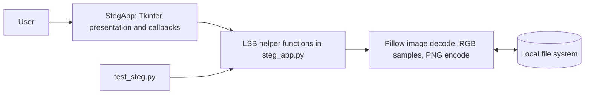

# Chapter 6 — Main Modules

## Architecture assessment

There is one application source file, [steg_app.py](../../steg_app.py), containing the Tkinter GUI and LSB helpers. No package boundaries or separately enforced layers exist. The “modules” below describe responsibilities in this monolithic file; they are not independent Python modules.

**Figure 1.** Runtime component architecture. No database, network service, or external application logic layer is present.

## Module architecture table

| Responsibility / module | Source | Inputs | Outputs | Dependencies | Workflow and error handling |
|---|---|---|---|---|---|
| Presentation / GUI | `StegApp`, `_create_notebook`, `_create_enc_tab`, `_create_dec_tab` | User paths, text, button events | Status labels and recovered text widget | `tkinter`, `ttk`, `filedialog`, `StringVar` | Calls encode/decode callbacks; UI checks a suffix and path existence, catches broad processing exceptions, and displays text. |
| Image validation | `StegApp._is_supported_image` | Path string | Boolean | `os.path` | Requires an existing file and one of a fixed suffix set; does not inspect image bytes itself. |
| Payload framing and encoder | `hide_message` | Input path, string, output path | Saved image and returned Pillow image | Pillow, UTF-8, `embed_bits_into_image` | RGB conversion, capacity check, header/payload bit lists, embedding, PNG save. Raises underlying errors or a capacity `ValueError`. |
| Pixel embedding | `embed_bits_into_image` | Pillow image, bit list, max bit count | New Pillow image | Pillow pixel API | Replaces RGB LSBs; raises `ValueError` if bit count exceeds `max_bits`. |
| Pixel extraction | `extract_bits_from_image` | Pillow image | Iterator of LSBs | Pillow pixel API | Yields R, G, B for 3/4-element pixels; other tuple sizes yield up to their first 3 channel values. Normal decode path has already converted to RGB. |
| Payload decoder | `extract_message` | Stego path | Python string | Pillow, extraction helper, UTF-8 | Reads header, validates length, rebuilds bytes; malformed UTF-8 is silently ignored by decoder policy. |
| Test harness | `test_steg.py` | Generated temporary RGB PNGs | Printed result and process exit code | Pillow, `tempfile`, project functions | Four tests; exceptions are counted by script-level runner. |
| Documentation generator | `generate_report.py` | Hard-coded report text/placeholders | `project_report.docx` | `python-docx` (not in requirements) | Separate generation utility, not called by application; claims in its prose are not authoritative over source behavior. |

## Function-to-module mapping

| Function or class method | Responsibility | Inputs / outputs | Caller and interactions |
|---|---|---|---|
| `rgb_to_bytes(r,g,b)` | Packs three components into a 24-bit integer | Three values → integer | No caller found in current project. |
| `int_to_rgb(value)` | Unpacks a 24-bit integer | Integer → RGB tuple | No caller found in current project. |
| `extract_bits_from_image(image)` | Yields channel LSBs | Pillow image → iterator of integers | Called by `extract_message`; helper supports tuple sizes but normal decoder uses RGB. |
| `embed_bits_into_image(image,bits,max_bits)` | Creates a modified image | Image, list of bits, integer → Pillow image | Called by `hide_message`. |
| `hide_message(image_path,message,output_path)` | Frames, embeds, saves message | Path, string, path → Pillow image | Called by GUI `_encode` and tests. |
| `extract_message(stego_path)` | Reads and decodes framed payload | Path → string | Called by GUI `_decode` and tests. |
| `StegApp.__init__()` | Initializes window/style/UI | No explicit parameters beyond `self` | Called at entry point. |
| `_is_supported_image(path)` | Path/extension validation | String → bool | Called by `_encode` and `_decode`. |
| `_create_notebook()` | Adds tab container | `self` | Called by `__init__`. |
| `_create_enc_tab()` | Constructs encode controls | `self` | Called by `__init__`; nested `browse_enc` updates a `StringVar`. |
| `_create_dec_tab()` | Constructs decode controls | `self` | Called by `__init__`; nested `browse_dec` updates a `StringVar`. |
| `_encode()` | Validates UI fields and invokes encoder | UI state → feedback | Button callback; derives `<base>_encoded.png`. |
| `_decode()` | Invokes decoder and updates widgets | UI state → feedback/output | Button callback; catches processing exceptions and writes error text. |
| `create_test_image(width,height)` | Creates solid RGB image | Optional dimensions → Pillow image | Called by encode/decode and UTF-8 tests. |
| `test_encode_decode()` | ASCII round-trip test | No explicit args → bool | Called by script runner. |
| `test_capacity_limits()` | Oversized-payload rejection test | No explicit args → bool | Called by script runner. |
| `test_utf8_support()` | Unicode round-trip test | No explicit args → bool | Called by script runner. |
| `test_multiple_images()` | Three dimension round-trip checks | No explicit args → bool | Called by script runner. |

`rgb_to_bytes`, `int_to_rgb`, and imported `ImageTk`, `messagebox`, and `IntVar` are not used by the current encode/decode path. Their presence does not imply implemented functionality.

## Error boundaries

The core functions allow Pillow, filesystem, conversion, and save errors to propagate. The GUI callbacks catch `Exception` and display its text, making the UI responsive to failures but hiding exception type/traceback from the user. The test runner also catches exceptions so it can report a failure count.
