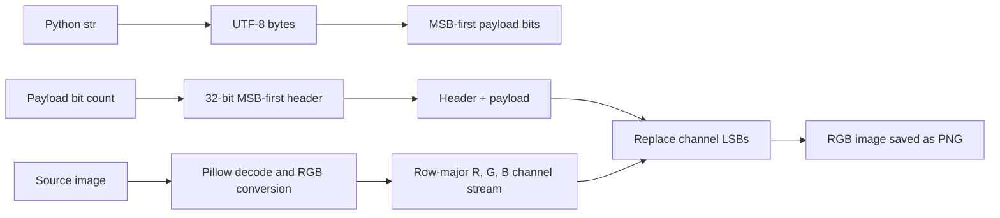

# Chapter 7 — Technical Overview

## 7.1 Technology stack

| Technology | What it is | Why required / where used | Version evidence |
|---|---|---|---|
| Python | Implementation language and runtime | Strings/bytes, integer bit operations, file paths, GUI callbacks, error handling; all logic in `steg_app.py`. | Python 3.14.4 in the configured local virtual environment; project manifest does not pin a Python version. |
| Tkinter / ttk | Python interface to Tcl/Tk GUI toolkit | `StegApp` window, tabs, controls, file dialogs, text area, events. | Standard-library imports; GUI dependency availability varies with Python distribution. |
| Pillow | Python imaging library | Open/convert/get pixel data/create/save images in helpers and tests. | `requirements.txt`: `pillow>=10.0.0`; inspected environment: Pillow 12.3.0. |
| `python-docx` | External library for Office Open XML documents | Imported only by `generate_report.py` to produce the legacy `.docx`. | Not listed in `requirements.txt`; generator is not needed to run app/tests. |
| `tempfile`, `os` | Standard library | Temporary test files and path checks. | Python standard library. |

## 7.2 Python

Python byte strings, Unicode strings, arbitrary-precision integers, shifts, bitwise operators, and iterators support this compact algorithm. The manifest specifies only a Pillow lower bound and leaves the Python version unspecified.

## 7.3 Tkinter

Tkinter supplies the native desktop event loop and widgets. `StegApp` subclasses `tk.Tk`, builds a `ttk.Notebook`, and wires buttons to callbacks. Python’s documentation describes Tkinter as its Tcl/Tk interface [2]. Neither the tests nor this report execute a GUI event loop.

## 7.4 Pillow

Pillow provides `Image.open`, `convert`, `getdata`, `Image.new`, `putdata`, and `save`. The program uses Pillow to operate on decoded image samples; Pillow’s image module documents the `Image` class and file factories [3].

## 7.5 PNG

The output suffix is `.png`; Pillow saves the output image. PNG is lossless, making exact sample persistence appropriate for LSB data [4]. The implementation accepts other formats as input and converts their decoded samples; robustness of an input format’s initial pixel values is a separate question.

## 7.6 RGB and pixel representation

The core path converts source images to RGB. Each pixel is `(R,G,B)`, with each component an 8-bit value in `[0,255]`. The alpha channel is discarded during conversion. Traversal of `getdata()` proceeds through the image in raster order.

## 7.7 Pixel representation and mathematical model

Let pixel `(x,y)` be `P(x,y)=(R(x,y),G(x,y),B(x,y))`, with each channel in `{0,...,255}`. The linear channel index for row-major traversal and R-G-B order is:

```text
k = 3(yW + x) + c
c = 0 for R, 1 for G, 2 for B
0 <= k < 3WH
```

Let `b_k` denote the framed message bit at position `k`. For the first `32 + L` channel positions, where `L` is payload length in bits, embedding is:

```text
C'_k = (C_k AND 254) OR b_k
```

All later channel values are intended to remain unchanged, with one implementation nuance: if `32+L` is not divisible by three, `next(bit_iter, 0)` writes zero to the one or two unused channels in the final touched pixel. These padding bits are not part of the declared payload and are ignored by extraction. For each replaced channel, `C'_k` differs from `C_k` by at most one.

The framed bit stream is `H || B`, where `B` is the UTF-8 payload bit sequence and `H` is the unsigned 32-bit MSB-first encoding of `L=8|B_bytes|`. Extraction reads `H`, parses `L`, then recovers precisely the next `L` channel bits. No other payload field is defined.

## 7.8 Bits and bytes

A payload byte comprises eight bits. A message with `M` UTF-8 bytes has `8M` payload bits. The implementation allocates Python lists of integer bits rather than streaming them directly into the image.

## 7.9 UTF-8

`message.encode("utf-8")` gives the payload bytes. On extraction, `bytes(message_bytes).decode("utf-8", errors="ignore")` returns text but removes malformed byte sequences rather than rejecting them. UTF-8 is an encoding form for Unicode text; see the Unicode Standard [5].

## 7.10 Bitwise operations

For each channel `C` and payload bit `b`:

```text
C' = (C AND 254) OR b
```

`254` is binary `11111110`. AND clears the least significant bit; OR sets it to `b`. Since `b ∈ {0,1}`, the other seven bits remain unchanged and `|C'-C| <= 1`.

## 7.11 LSB and bit order

The encoder stores header bits for loop indices 31 down to 0, then payload byte bits for shifts 7 down to 0. Extraction reads the channel parity and reconstructs integer values by left-shifting. The channel order is R then G then B for each row-major pixel.

## 7.12 Header and payload

The 32-bit unsigned header represents payload length in **bits**, not bytes. Because the payload is byte-aligned, valid lengths are multiples of eight. The payload immediately follows. There is no magic value, version, charset identifier, checksum, or encryption metadata.

## 7.13 Capacity

For `W × H` RGB pixels:

```text
N = 3WH channel slots
payload capacity in bits = max(0, N - 32)
maximum whole payload bytes = max(0, floor((N - 32) / 8))
```

The encoder compares `8M` with `N - 32`. For `N < 32`, this check rejects even empty bytes because the right-hand side is negative. The normal GUI rejects blank messages before calling it.

The prefix has a finite unsigned 32-bit representation, while the implementation does not explicitly check that `msg_len_bits` fits in 32 bits before constructing the bit list. Practical memory constraints are likely to intervene for enormous messages, but the encoding format’s formal ceiling is less than `2^32` bits. This extreme boundary is untested.

## 7.14 Encoding

Encoding converts to RGB, UTF-8 encodes text, computes bit length, checks capacity, constructs two lists (header and payload), concatenates them, embeds via `embed_bits_into_image`, and saves the new image.

## 7.15 Decoding

Decoding converts to RGB, reads 32 LSBs for the header, checks `L mod 8 == 0` and `L <= N-32`, then rereads the first `32+L` bits. Payload bytes are reconstructed eight bits at a time and decoded with ignored UTF-8 errors.

## 7.16 File handling

The GUI checks that paths exist and suffixes belong to its supported set. Pillow performs actual image parsing. Encoding output replaces the final suffix with `_encoded.png`; if source and output paths coincide for unusual suffixless paths, the UI only supplies normal files with extensions. Saving is not atomic and no overwrite confirmation is implemented.

## 7.17 Error handling

The encoder raises `ValueError` for insufficient capacity. The decoder raises for too-small images, non-byte-aligned lengths, and lengths above capacity. Pillow may raise for invalid/unreadable files and save failures. The UI catches broad exceptions and places their string representations in feedback. UTF-8 malformed sequences are ignored, not surfaced as errors.

## 7.18 Testing

`test_steg.py` tests four categories by creating images and asserting outcomes through returned booleans. It does not use a standard test framework, test GUI widgets, calculate coverage, or benchmark performance. The actual run is documented in [Chapter 15](./15_Software_Testing.md).

## 7.19 Data-processing pipeline



**Figure 9.** The data path that is implemented. There is no encryption/compression stage.

## 7.20 Research trade-offs

The classical capacity–imperceptibility–robustness tension is relevant as an analytical framework, not as a measured result in this project. Using more channel LSBs carries more payload but overwrites more sample parities, potentially changing image statistics. Direct spatial replacement is fragile when later processing changes sample values. The project has no adaptation or empirical evidence about detectability, image quality, or robustness.
