# Chapter 9 — Block Diagram

```mermaid
flowchart LR
  USER[User]
  IMG[Input image path]
  MSG[Secret message text]
  GUI[StegApp GUI]
  VAL[Path and message checks]
  ENC[hide_message]
  UTF[UTF-8 bytes]
  HDR[32-bit payload-length header]
  BITS[MSB-first header and payload bit stream]
  LSB[RGB row-major LSB embedding]
  SAVE[Pillow save as PNG]
  STEGO[Stego image file]
  DEC[extract_message]
  EXT[RGB LSB extraction]
  RECON[Payload byte reconstruction]
  UTFDEC[UTF-8 decode, errors ignored]
  OUT[Recovered text in GUI]

  USER --> GUI
  IMG --> GUI
  MSG --> GUI
  GUI --> VAL --> ENC
  ENC --> UTF --> HDR
  HDR --> BITS --> LSB
  IMG --> ENC
  LSB --> SAVE --> STEGO
  STEGO --> DEC --> EXT --> RECON --> UTFDEC --> OUT
  GUI --> OUT
```

**Figure 2.** Encoding and decoding blocks based on the two core functions. The header is derived from the UTF-8 payload length; it precedes, rather than wraps, the payload.

## Block-by-block description

| Block | Input | Output / role | Implementation |
|---|---|---|---|
| User | Image choice and text | UI actions | Human interaction; no authentication. |
| GUI | Paths, message, clicks | Validated callback invocation and visible feedback | `StegApp`, file dialogs, variables, buttons. |
| Validation | Path, suffix, text | Allow/reject decision | `_is_supported_image`, whitespace test. |
| UTF-8 | Python string | Byte sequence | `message.encode("utf-8")`. |
| Header | Payload byte count | 32 bits expressing payload bit count | `msg_len_bits`, 32-iteration comprehension. |
| Bit stream | Header and byte bits | Ordered list of 0/1 | Header and payload are MSB-first. |
| LSB embedding | RGB image and bit list | New image with channel LSBs replaced | `embed_bits_into_image`. |
| Save | Modified RGB image | PNG file | Pillow `save(output_path)`. |
| Extraction | Encoded image | Header and payload bits | `extract_bits_from_image` plus loops. |
| Reconstruction | Payload bits | Bytes | Eight bits combined at positions 7 down to 0. |
| UTF-8 decode | Bytes | Python string | `decode("utf-8", errors="ignore")`. |
| Output | Decoded string | Text-area contents/status | `_decode`. |

The diagram does not show a separate database, encryption layer, message authentication module, checksum, key store, or network communication because none exists.
