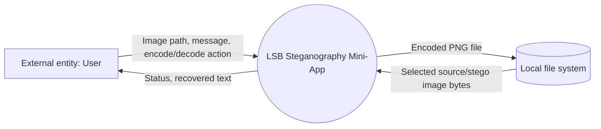
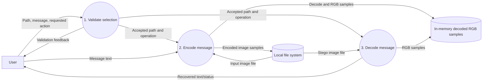
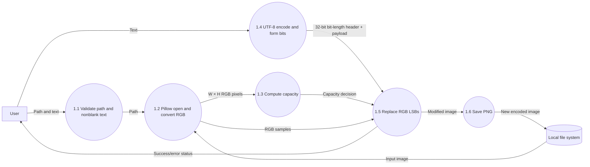
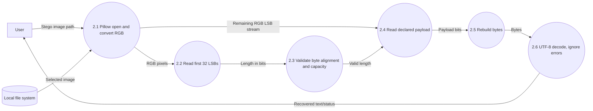

# Chapter 10 — Data Flow Diagram

The diagrams show local file and in-memory data flows. No database is involved.

## 10.1 Context DFD

**Figure 3.** Context-level view. The file system is shown as a local storage boundary, not a database.

## 10.2 Level-0 DFD

**Figure 4.** Level-0 DFD; the in-memory sample store is transient process memory, not persistent storage.

## 10.3 Level-1 DFD

### Encoding path

### Decoding path

**Figure 5.** Level-1 operations. The decoder has no signature check; a non-stego image can contain a plausible header by chance.

## Data-flow notes

- Encode reads an image and text; it writes a new image.
- Decode reads a selected image and returns text only to the GUI.
- Status/errors flow to the user interface.
- No persistent message history, configuration store, database, or remote endpoint is present.
