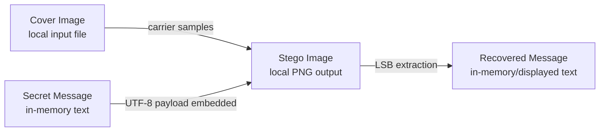

# Chapter 11 — Conceptual Data Model (ER Diagram)

**No relational database is implemented.** The application is file-based and stores no persistent records about encoding sessions. The following is a **CONCEPTUAL DATA MODEL, NOT A DATABASE SCHEMA**. Its boxes denote conceptual artifacts in a workflow; it does not imply database tables, primary keys, or saved relationships.

**Figure 6.** Conceptual artifacts and transformations.

| Concept | Actual representation | Persistence |
|---|---|---|
| Cover image | User-selected input file decoded by Pillow | Existing local file |
| Secret message | Python string in `StringVar` / function argument | Not saved separately by this app |
| Stego image | Newly generated RGB image saved with `.png` suffix | Local output file |
| Recovered message | Python string displayed in a Tkinter text widget | Not saved separately |

