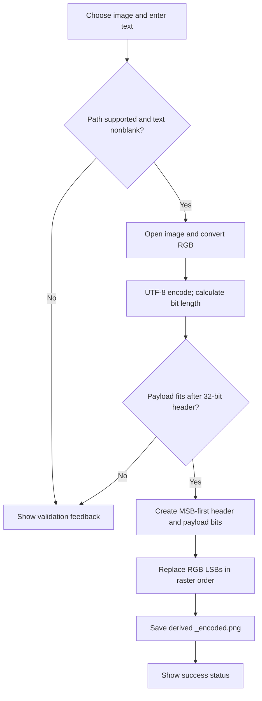
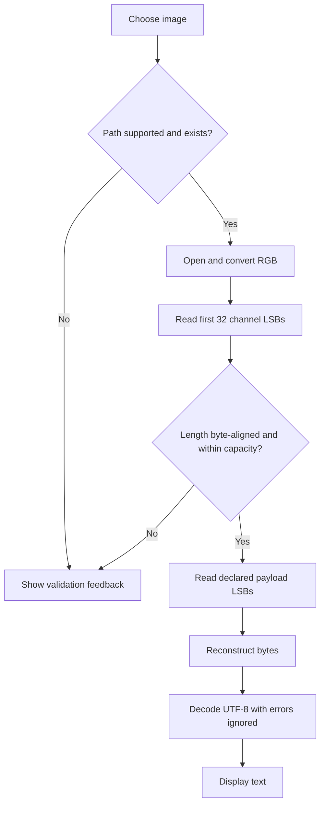

# Chapter 12 — Project Explanation

## 12.1 Startup

When `steg_app.py` is executed directly, the `__main__` block constructs `StegApp()` and calls `mainloop()`. This starts Tk’s event loop. Importing the module for tests does not construct a root window.

## 12.2 GUI initialization

`StegApp.__init__` sets title, geometry, minimum size, resize behavior, and styles, then creates the notebook and its Encode and Decode tabs. UI construction is synchronous.

## 12.3 Input selection

Nested `browse_enc` and `browse_dec` callbacks use `filedialog.askopenfilename` with a broad list of suffix filters. A chosen path is copied to a `StringVar`. The filters are convenience UI constraints, not proof that the bytes form a valid image.

## 12.4 Message entry and validation

The encode tab uses a single-line `Entry` tied to `self.enc_msg`. `_encode` rejects a missing/non-supported path and a message for which `message.strip()` is empty. The core `hide_message` function itself does not reject empty or whitespace-only strings; this blank validation is a GUI behavior.

## 12.5 Encoding, header, and payload

`hide_message` opens and converts the input to RGB. It UTF-8 encodes the string, computes `msg_len_bits = len(msg_bytes) * 8`, and rejects it if larger than total channel capacity minus 32. It produces a 32-bit MSB-first header followed by each payload byte MSB-first.

## 12.6 Embedding and image reconstruction

`embed_bits_into_image` iterates image pixels. For pixels with at least three tuple elements, it replaces R/G/B LSBs with the next three bits, using zero for exhausted bits. It stops when `len(new_pixels)*3 >= len(bits)`, then appends untouched source pixels. It builds a new image in the input image’s mode. The main path supplies RGB, so pixels have three channels. The helper’s `max_bits` argument is compared with `len(bits)` but does not otherwise limit traversal.

## 12.7 Saving

`_encode` derives an output path by splitting the selected name at the final dot and adding `_encoded.png`. `hide_message` saves the resulting image. The source file is not used as the output path for ordinary extension-bearing images. The UI shows the basename after success.

## 12.8 Decoding, extraction, and reconstruction

`extract_message` opens the selected image and converts it to RGB. It checks for at least 32 channel positions, reads the first 32 LSBs, rebuilds the declared bit length, checks divisibility by eight and that it does not exceed remaining capacity, then reads the declared stream. It reconstructs bytes and decodes with invalid sequences ignored.

## 12.9 Display and error handling

On success `_decode` enables the output text widget, replaces its contents, disables it again, and updates feedback. On exceptions it writes an error message into the output widget and reports it in the feedback label. `_encode` catches exceptions and reports text only. Broad exception handling is a UI boundary, not a guarantee that every failure is meaningfully classified.

## 12.10 Error-condition table

| Condition | Core/UI behavior | Evidence |
|---|---|---|
| Empty image path or nonexistent path | GUI returns a validation message | `_is_supported_image` |
| Unsupported suffix | GUI rejects before processing | `_is_supported_image` suffix allowlist |
| Unreadable/corrupt image | Pillow exception is caught by callback and displayed | `_encode`, `_decode` |
| Blank/whitespace message | GUI rejects; direct function call is not similarly guarded | `_encode` |
| Payload too large | Encoder raises `ValueError` | `hide_message`; capacity test |
| Image has less than 32 channel slots | Decoder raises `ValueError` | `extract_message` |
| Header bit count not divisible by 8 | Decoder raises `ValueError` | `extract_message` |
| Declared length exceeds remaining capacity | Decoder raises `ValueError` | `extract_message` |
| Invalid UTF-8 payload | Invalid bytes are silently skipped | `decode(..., errors="ignore")` |
| Save permission/disk error | Pillow/OS error is caught by encode callback | `_encode` |

## 12.11 Complete example (symbolic)

For text `"A"`, UTF-8 is byte `0x41`, bit pattern `01000001`; length is 8 bits. The header is 32-bit value 8, with leading zeros. The stream starts with header `00000000 ... 00001000`, then `01000001`. These 40 bits replace the first 40 RGB channel LSBs (13 full pixels and one channel of the next pixel). This example follows the source code’s bit order; it is a representation example, not a measured image output.

## 12.12 Encoding workflow

**Figure 7.** Encode sequence.

## 12.13 Decoding workflow

**Figure 8.** Decode sequence. The length checks detect some malformed inputs but do not authenticate the carrier.
